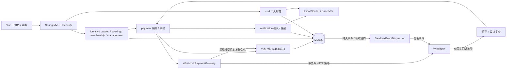
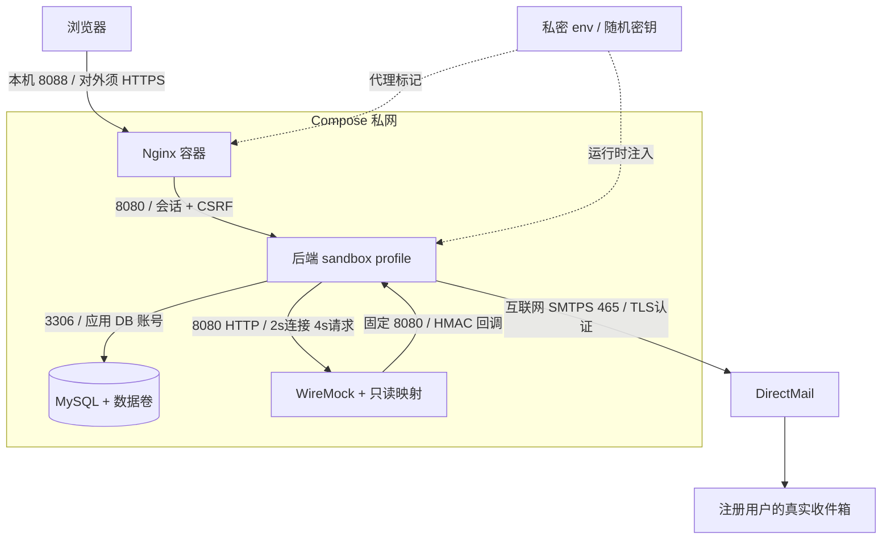
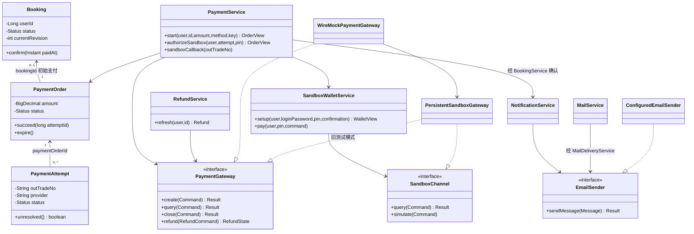
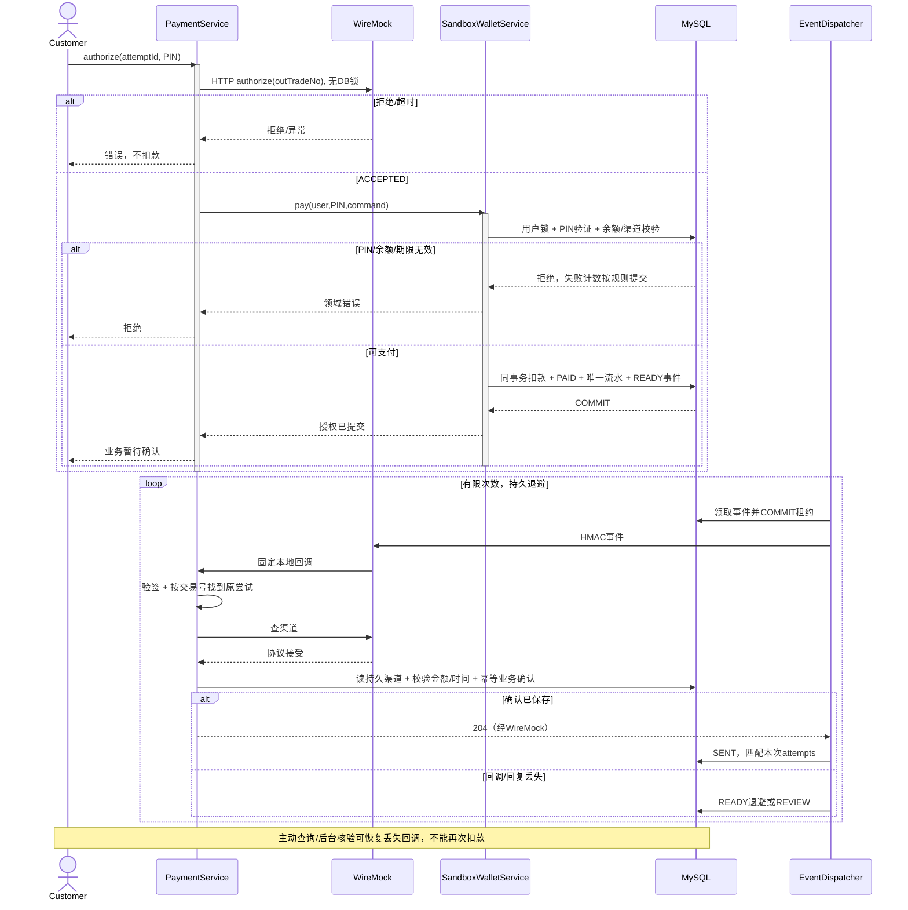
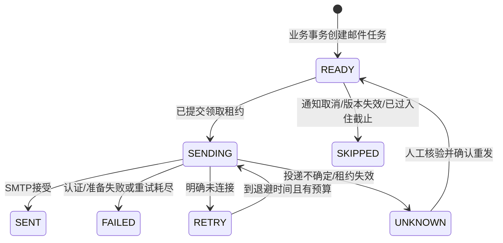
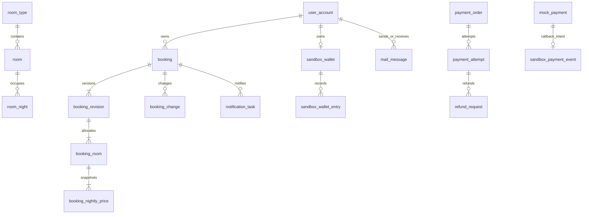

# 当前设计基线：WireMock / DirectMail

版本：2026-11-07，工作副本基线。本文为 Appendix 2 撰写提供与代码对应的设计依据，**不是已排版提交、已签署或已全部验收的最终报告**。逐项进度见 [Implementation Review](Implementation-Review.md)，原始问题见[整改清单](Design-Report-逐节审查与改进清单.md)。

## 1. 目的、范围与来源

系统为单酒店 Holiday Booking，包含游客浏览、三角色权限、报价/占房/预订、会员、取消改订、钱包模拟支付退款、个人邮箱、系统通知与运营管理。需求基线为 `docs/reports/Holiday-Booking-Requirements-Specification-v2.0.docx` 的 FR01–19、CR1–3、NFR01–05；访谈来源仍是已明确标注的模拟场景，不能写成真实访谈。

用户最新决定：支付不依赖第三方收款，采用 WireMock 本地模拟；邮件采用真实 DirectMail，停用 Mailpit。WireMock 是外部进程依赖，不是第三方资金服务，SRS 中 Alipay/Wechat 的模拟标签含义不变。SMTP 已认证/提交的历史证据不等于整套邮箱业务已验收。

参考资料为根目录 Appendix 2 模板、课程长度约束、SRS、实际 pom/package-lock、Flyway V1–V6、Compose 与[支付邮件指南](../支付与邮件部署.md)。原 2026-10 开发前技术文档是历史规划，不替代本文。

## 2. 质量优先级与分层

设计取舍顺序：资金/库存正确性及隐私边界 → 故障可恢复性 → 可维护性 → 性能与操作便利性。UNKNOWN 暂时保留占房，牺牲部分短期可售量，防止错误释放；退款失败与订单取消分别记录，不能靠回滚业务取消掩盖已经发生的资金操作。

架构是按业务模块组织的分层单体，关键集成采用端口/适配器；不是无框架依赖的纯领域模型。JPA/Lombok 实体、Spring 事务和服务协作是明确取舍。

| 层 | 职责与依赖规则 |
| --- | --- |
| api | HTTP DTO、输入格式、认证身份，调用 application；不直接扣款或写业务 SQL |
| application | 编排用例、所有权、幂等与事务；依赖 domain 端口和稳定跨模块用例 |
| domain | 状态、不变量、值对象和 Repository/Gateway 端口；不依赖项目 api/infrastructure |
| infrastructure | JPA/JDBC、HTTP/SMTP、模板和签名适配；实现领域端口 |
| shared/config | Boot 组合根、事务、安全和环境装配，允许引用具体适配器 |

`DesignBoundaryTest` 对 domain/application 的项目适配器依赖做检查。跨模块调用仍较多，不宣称已做到完全独立部署或严格模块封装。

## 3. 技术栈与边界图

| 技术 | 当前用途/约束 |
| --- | --- |
| Java 21 / Spring Boot 4.1.1 | MVC、Validation、Security、JDBC Session、调度、Actuator/Micrometer |
| JPA + JdbcClient / Flyway | 聚合持久化、显式锁/队列 SQL、版本化迁移；Hikari 最大 10、READ_COMMITTED |
| MySQL 8.4 | 工作库和隔离数据库测试；UTC 存储，应用酒店时区 Asia/Shanghai |
| Vue 3 / TypeScript / Pinia / Router | 原生 fetch、自有组件；实际版本由 package-lock 固定，没有使用 Axios/Element Plus |
| WireMock 3.13.2-2 / JDK HttpClient | 固定 HTTP 契约、故障覆盖、代理签名事件；MySQL 承担沙箱持久化 |
| DirectMail / Spring Mail | SMTP TLS，统一酒店 From，用户 Reply-To，异步队列 |
| Docker Compose / Nginx | 预构建镜像、私网依赖、只读应用文件系统和持久卷；公开发布另配置 HTTPS |

WireMock 镜像已固定版本；其余基础镜像仍需发布时冻结摘要。当前运行不依赖 H2、Mailpit、Alipay 公网回调或收费支付账号。





开发时 Nginx 换为 Vite5173，Java 在宿主机8080，MySQL 发布回环3307、WireMock 发布回环9090，回调通过 host.docker.internal。部署只发布 Nginx 回环端口；WireMock 管理 API 绝不经网页代理公开。

## 4. 集成契约、失败与恢复

| 依赖 | 端口及自有数据 | 超时/幂等 | 故障语义 |
| --- | --- | --- | --- |
| WireMock HTTP | PaymentGateway.Command/Result、RefundCommand/State；请求 operation/outTradeNo，响应重复两字段并给 decision | 连接2s、请求4s；outTradeNo / requestNo 稳定，禁止自动重定向 | 拒绝、不可用、协议错误明确分类；不静默回退“成功” |
| 本地钱包/渠道 | SandboxChannel、SandboxWalletRepository、持久化交易/流水 | 同一用户锁先于渠道锁；扣款与 PAYMENT 唯一流水、事件同事务 | 错 PIN、锁定、低余额、已关闭均无新扣款；历史无付款流水不造退款余额 |
| 签名回调 | SandboxCallbackAuthenticator；原始 JSON 只含 outTradeNo | HMAC-SHA256(timestamp+换行+body)，±300s；事件交易号唯一 | 无会话依赖，错签403；事件仅提示，必须复查渠道并校验资金；重复幂等 |
| DirectMail | EmailSender.Message/Result；Reply-To/To/subject/body | 连接5s、读10s、写10s；不承诺 SMTP 恰好一次 | SENT仅代表接受；连接失败 RETRY，认证/准备 FAILED，不确定 UNKNOWN |
| MySQL | Repository 端口、Flyway、租约/唯一键 | 连接获取5s、配置查询预算5s、池10；业务键+哈希 | DB 不可用拒绝写操作，不伪造只读缓存或邮件成功 |

网络请求一律放在业务事务外。钱包事务中调用 SandboxChannel 的 query/simulate 是本库操作，不调用 WireMock；外部 HTTP 预检在拿锁前完成。回调/SMTP 工作者先提交领取租约，再联网，最后新事务保存结果。

| 场景 | 用户看到/业务状态 | 恢复和一致性 |
| --- | --- | --- |
| 创建渠道超时 | 原尝试 UNKNOWN，不能再创建另一在途交易 | 复用原交易号核验；WireMock 本地创建未落库时可幂等补建原渠道记录 |
| 授权拒绝/低余额 | 明确拒绝，不获权益 | 原子事务无扣款；改正原因后继续原尝试或关闭 |
| 扣款后回调丢失 | 业务暂时待确认，付款记录已持久化 | 事件重试或主动查询确认，不再扣款 |
| 已付但迟到/金额不一致 | 支付异常，不强行确认 | 管理员复核，保留原资金记录；备注不等于退款完成 |
| 支付/退款长期故障 | 保留待确认，不错误释放库存/增加余额 | 每笔数据库租约与退避，12次失败转人工预算释放 |
| 回调工作进程崩溃 | SENDING 租约过期 | 重发签名提示；最多8次，超限 REVIEW；完成更新检查本次 attempts 防止旧工作者覆盖 |
| SMTP 不确定或任务租约丢失 | UNKNOWN，不能盲目重发 | 人工核对 DirectMail/收件箱后显式确认重试 |
| 个人邮件耗尽可用预算 | 待发送 | 至少1封、通常20%日预算留给系统通知；次日恢复预算 |

支付与 SMTP 采用单实例熔断：连续5次失败、打开30s、一个半开探测。支付/退款自动恢复的失败退避从60s倍增至最多1800s；健康待付款轮询为60s。邮件保留1/5/30分钟退避。数据库租约跨实例共享，熔断内存不共享，不能宣称分布式熔断。

HTTP 有 traceId；两类邮件和支付事件保存 source_trace，工作者恢复日志上下文。Micrometer 提供调用结果/耗时、邮件队列年龄、UNKNOWN、异常/人工恢复数量；指标只允许管理员访问。外部告警接收端、DirectMail 投递反馈/投诉、供应商额度抓取仍未装配。

## 5. 对象职责与接口

核心对象图用于表达职责；完整提交报告应按最终选择的 5.1 类图范围同步 CRC，不必为每个 DTO/框架类型创建无意义 CRC。



图中省略 BookingChange/MembershipPurchase 关联：应付单按初始预订、会员购买或补款变更三者之一关联；不能把图中的初始支付关系误读为所有应付单都必须有 bookingId。箭头为代码导航方向；数量依具体关联类型，不代表可删除历史。

| CRC：图中每个类/接口 | 责任 | 主要协作者 |
| --- | --- | --- |
| Booking | 预订状态、版本和时间范围 | BookingService、CatalogRepository |
| PaymentOrder | 可信金额、期限、成功尝试 | PaymentService、PaymentAttempt |
| PaymentAttempt | 原渠道、交易号及不可倒退的尝试状态 | PaymentOrder、PaymentGateway |
| PaymentService | 三阶段渠道编排、所有权、结果验证、业务推进 | Gateway、Wallet、Booking/Change/Membership services |
| SandboxWalletService | PIN验证/锁定、余额、原子扣款与流水 | SandboxChannel、WalletRepository、IdentityRepository |
| RefundService | 原退款号核验、成功/未知保存与审计 | RefundRepository、PaymentGateway |
| PaymentGateway | 隐藏传输实现，返回应用自有支付类型 | PaymentService、RefundService、适配器 |
| SandboxChannel | 钱包事务可调用的本地渠道操作 | Wallet、PersistentSandboxGateway |
| WireMockPaymentGateway | 事务外 HTTP 契约和故障校验后委托持久账本 | HttpClient、IntegrationCircuit、PersistentSandboxGateway |
| PersistentSandboxGateway | 渠道交易、幂等退款、原子回调意图 | JdbcClient、WalletRepository、IdentityRepository |
| NotificationService | 确认/D3/D1任务、过期抑制与投递编排 | NotificationRepository、EmailSender、MailTemplate |
| MailService | 注册收件人、个人副本/回复/删除权限及审计 | MailRepository、IdentityRepository、MailDeliveryService |
| EmailSender | 统一传输输入及 SENT/RETRY/UNKNOWN/FAILED 结果 | 两类出站任务、ConfiguredEmailSender |
| ConfiguredEmailSender | From/Reply-To、TLS SMTP装配、错误分类与熔断 | Spring Mail、IntegrationCircuit |

值对象/枚举另列：Money 为两位小数非负金额，逐晚 HALF_UP；折后零价格由报价用例拒绝。Stay 为酒店日期的半开区间 `[checkIn,checkOut)`。QuoteSnapshot 固化逐晚价/折扣/房间人数。角色只有 CUSTOMER/STAFF/ADMIN，会员非角色。支付方法严格 `Alipay/Wechat`，不得把大小写相近字符串当成同一方法。

领域错误由 DomainException 的 Kind/稳定 code 映射为 400/403/404/409/429/503；PaymentChannelException 区分拒绝、配置、暂不可用、响应无效。未知外部结果不能套用“异常=未发生”的假设。退款端口当前只有 SUCCEEDED/UNKNOWN，这一限制在最终报告应如实声明。

## 6. 时序与状态





SKIPPED 仅适用于通知任务；个人邮件没有该状态。支付尝试为 CREATED→PENDING/UNKNOWN→SUCCEEDED/CLOSED/EXCEPTION；SUCCEEDED 不因重复关闭/待付事件回退。预订为 PENDING_PAYMENT→CONFIRMED、CANCELLED 或 EXPIRED；确认取消/改订还须通过政策/退款状态校验。完整提交版应把各状态机分别绘制，不能把这个邮件简图当成所有实体的完整状态定义。

## 7. 数据库与数据生命周期



图为主要关联子集；V1–V6 SQL 是 PK/FK/索引/检查的完整来源。会员、会话、审计、幂等、配额及封房表不能因未画进简图而在正式数据字典遗漏。

关键约束：`room_night(room_id,stay_date)` 主键防止同房同晚双占；用户、房型和房间按既定顺序加锁；`booking_revision(booking_id,revision_number)` 唯一；支付交易号、退款号、钱包 reference、回调交易号唯一。V6 事件 FK 指向持久本地交易；恢复键为 PAYMENT/REFUND/CALLBACK 的应用级多态键，无法用单个 FK 表达。新增索引覆盖队列状态/下次时间，使用短事务领取。

列表查询仅返回 BookingSummary，不加载每笔房间、晚价或应付单；详情房间/晚价使用两次批量查询，消除按房间逐次读取。客户端同步使用 summary 类型。尚缺实际 10,000 笔数据下的执行计划/延迟证据，不能把消除 N+1 等同于达到 NFR01。

迁移：首次升级先备份，Flyway forward-only，禁止重写已应用版本；V6 未在本轮工作库执行。发布失败优先回滚兼容应用镜像，数据库破坏性回滚需离线恢复演练。备份命令：

```powershell
python scripts/Database-Maintenance.py backup --mode Development
python scripts/Database-Maintenance.py verify-backup --file .local/backups/实际文件.sql
python scripts/Database-Maintenance.py retention-preview --mode Docker
```

备份是本地未加密 SQL，须限制文件 ACL、加密后传输，不进入镜像/共享 results。校验和只证明文件一致，不能证明能恢复。恢复演练要求：另起隔离 MySQL8.4（独立新卷/新端口，绝不指向工作卷），导入单库备份，核对 Flyway 历史、业务/资金/队列数量和外键，再用关闭 SMTP/任务的后端只读验证。恢复时间和失败回退留存证据；本轮未执行。

拟定保留策略需团队确认：未消费过期报价30天后可清理；双方均删除的终态个人邮件90天后可脱敏正文；审计、支付/退款/幂等和 UNKNOWN 不随邮件清理而删除，遵循课程/组织要求另定保留期。当前工具只预览候选，不自动擦除、失效幂等键或破坏回复 FK。此项仍是生命周期实现/评审缺口。

## 8. 安全、运维和成本

后端强制 CUSTOMER 业务权限及所有权，STAFF/ADMIN 管理接口再分权限；每请求重新查角色，CSRF保护普通写请求，登录后更换会话 ID。密码/PIN BCrypt12，PIN防猜测计数独立提交。签名回调仅精确路径免 CSRF，不免 HMAC。

Docker 后端无宿主机端口，Nginx 用运行时私密标记覆盖客户端地址，后端只在标记匹配时采纳该地址；忽略普通任意 X-Forwarded-For。开发直连按真实 TCP 地址限流。429 统一 traceId，不泄露完整密码、SMTP响应正文或私人邮件内容。

配置不进前端，生产提供打包资源而非 Vite；前端代码可被浏览器读取是正常机制，不能把混淆作为权限措施。Nginx 有 CSP/安全头/源码路径限制，WireMock 管理和回调不经浏览器入口公开。对外 HTTPS、安全 Cookie、秘密轮换/备份加密与交付扫描需发布环境落实。

支付只用模拟资金，不收银行卡/供应商真实支付密码，不宣称 PCI 认证。MySQL/WireMock 消耗本机资源，DirectMail 实际额度/费用由账号区域与产品决定；应用日预算是防误发措施，不承诺服务商免费层。需关注 SMTP接受量、失败、UNKNOWN、队列年龄和人工恢复；告警接收渠道待配置。

## 9. 追踪与验证

下表是设计责任/测试入口映射，不是逐条已通过证明。完整输入/预期由 `scripts/test-cases.json` 与 Java CaseSpec 管理，用户执行后覆盖实际结果。

| SRS | 设计入口/责任对象 | 主要验证入口 |
| --- | --- | --- |
| FR01 | CatalogService、公开 ExploreView | CatalogServiceTest、游客浏览验收 |
| FR02 | BookingService、Booking/QuoteSnapshot | BookingServiceTest |
| FR03 | PaymentService.apply、PaymentGateway | PaymentFlowTest、WireMock E2E |
| FR04 | CatalogService、ManagementController | CatalogServiceTest、ManagementApiTest |
| FR05 | room_night/RoomBlock、库存锁 | CatalogServiceTest |
| FR06 | BookingSummary/详情、管理权限 | ManagementApiTest、列表负载 |
| FR07 | MembershipService、支付确认 | MembershipLifecycleTest |
| FR08 | Money、权益/逐晚快照 | DomainRulesTest、MembershipLifecycleTest |
| FR09 | NotificationService、D1任务 | NotificationDeliveryTest、真实收件 |
| FR10/11 | PaymentValidator、支付错误 | PaymentRulesTest |
| FR12 | SecurityConfig、IdentityService | ApiSecurityTest（含新顾客接口角色用例） |
| FR13 | 用户/房间锁、room_night 唯一键 | BookingServiceTest、MySqlBookingIT |
| FR14 | BookingQuote、期限/权益快照 | BookingServiceTest、DesignBoundaryTest |
| FR15 | 两类持久邮件队列、DeliveryPolicy | EmailAdapterTest、NotificationDeliveryTest、MailboxTest |
| FR16 | PaymentService.reconcile、恢复预算 | PaymentRecoveryTest、故障/重启验收 |
| FR17 | SandboxWalletService、余额/流水 | SandboxWalletTest、SandboxWalletApiTest、SandboxProtocolTest |
| FR18 | MailService、DirectMail、个人副本 | MailboxTest、三角色真实收件 |
| FR19 | 管理权限、异常复核与恢复释放 | ManagementApiTest、管理员实机验收 |
| CR1/CR2 | BookingChangeService、RefundService | BookingChangeTest、退款故障验收 |
| CR3 | 日历 D3/D1、过期抑制 | NotificationDeliveryTest |
| NFR01 | 摘要/批量查询、池/分页 | 50会话、5分钟、100房/10000预订、p95≤2s及无5xx，待测 |
| NFR02 | 角色/所有权/CSRF/HMAC/秘密边界 | ApiSecurityTest、签名测试、HTTPS/交付检查 |
| NFR03 | 原子账本/事件、幂等退款、租约 | 钱包/恢复测试、容器杀进程与重启，后者待测 |
| NFR04 | 角色导航、错误/状态、酒店时区 | 浏览器键盘和200%缩放，待测 |
| NFR05 | 分层/迁移/预构建镜像/UTF8 | DesignBoundaryTest、Compose、跨机器恢复，后者待测 |

本轮证据为编译/格式、8项针对性测试与 Compose 解析。Docker 引擎未运行，完整 MySQL、真实 WireMock、浏览器、SMTP业务收件与性能验收尚缺。最终报告还需控制课程页数、完善图例/编号、完整数据字典及团队签署，不能用本文存在代替成品验收。
