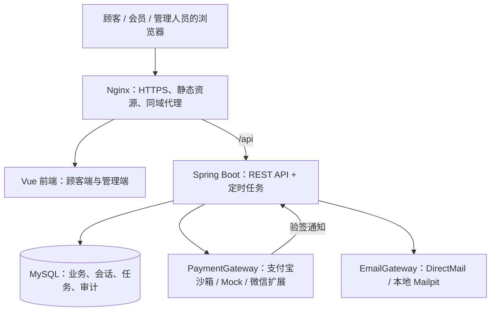
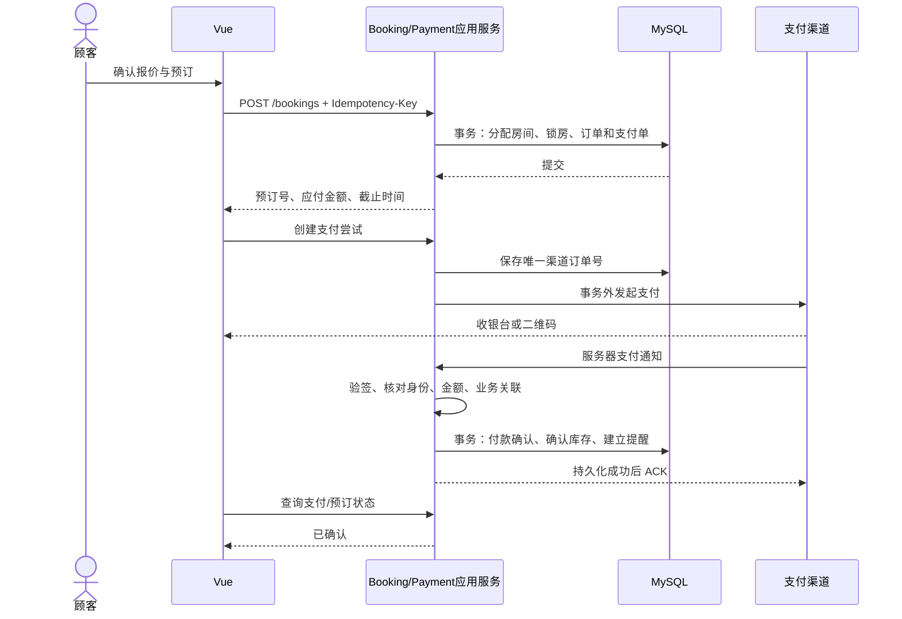
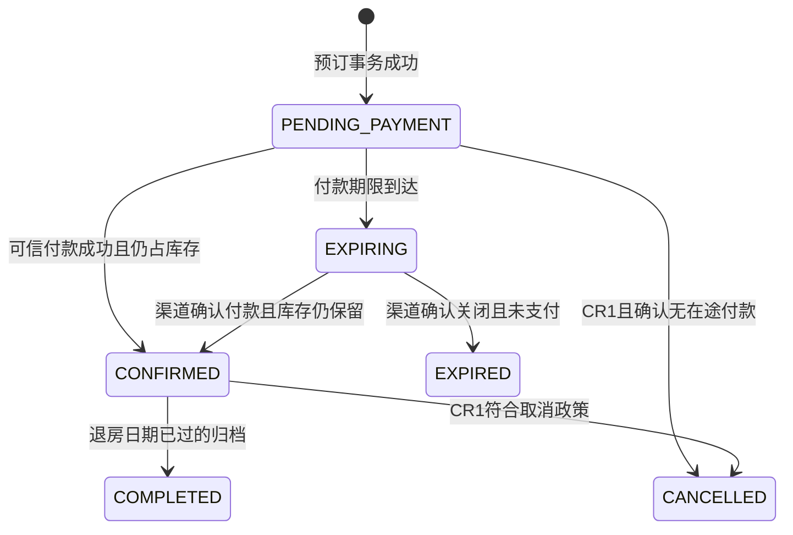
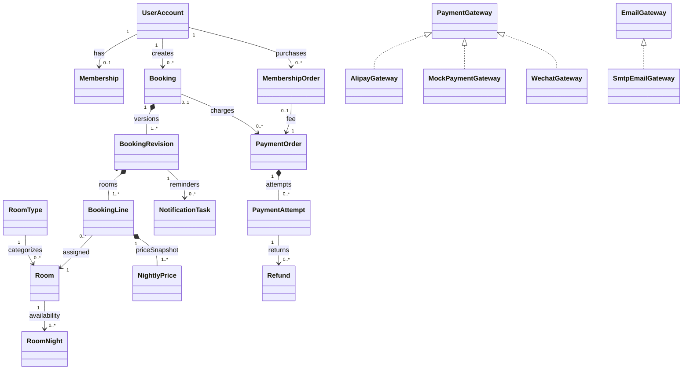
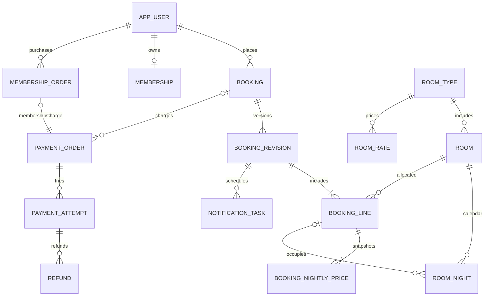

# Holiday Resort Booking System 开发技术文档

**版本：1.0 · 日期：2026-10-21 · 状态：开发前的需求分析与设计基线**

本项目面向单个度假酒店，实现顾客查询客房、预订、付款、付费成为会员、享受折扣，以及管理人员维护客房和查看订单。推荐采用 **Vue 3 + TypeScript 前端、Java 21 + Spring Boot 后端、MySQL 8.4 数据库**，以模块化单体完成课程规模的全栈系统。

本文给出可以据此拆分开发任务的设计，不表示程序、支付接入或测试已经完成。所有示例价格、时限和性能指标都是建议基线；原始材料没有规定的部分均作为设计决策标明。

## 阅读导航

| 需要了解的内容 | 章节 |
|---|---|
| 原文究竟要求什么、哪些只是建议 | 1–3 |
| 用什么技术、系统如何分层 | 4–5 |
| 业务流程、价格、库存、支付和邮件规则 | 6–8 |
| Java 类设计和数据库设计 | 9–10 |
| API、前端页面和交互设计 | 11–12 |
| 安全、质量目标、测试与用户测试 | 13–15 |
| 取消、改订和三天提醒的变更设计 | 16 |
| 部署、开发顺序、课程交付及待确认项 | 17–20 |
| 官方技术资料和核查结果 | 21 |

## 1. 材料范围与解释原则

### 1.1 已阅读的文件

| 编号 | 文件 | 页数 | 在本文中的地位 |
|---|---|---:|---|
| S1 | `SE Group ProjectSG_revised.pdf` | 10 | 课程案例、评分、提交规则的主要依据 |
| S2 | `Suggested conisderation for services accessible in China for payment email DB - subject to your design decisions.pdf` | 5 | 外部服务的可选建议，不等同于强制技术栈 |

页码均指 PDF 物理页码。逐页文本提取稿保存在 `docs/design/source-extracts/`，便于回查。当前目录未提供 S1 第 7 页所称的独立 RS、OOD、Test Plan/Test Report 模板，也没有现有代码、数据库或用户访谈记录。本文不推定这些材料的具体内容。

### 1.2 需求标记

| 标记 | 含义 | 开发处理 |
|---|---|---|
| **R：原文要求** | S1 明确要求的业务或提交内容 | 必须追踪到设计和验收 |
| **D：设计补充** | 为实现可靠系统而选择的规则与技术 | 纳入建议实现，允许经评审调整 |
| **CR：变更要求** | Q8 的取消、改订、三天/一天提醒 | 必须完成设计与一致性验证；原文明确不要求实现 |
| **E：可选增强** | 没有被案例要求的功能 | 基础闭环完成后再评估 |

本次范围是完整技术方案。主实现基线为 **R + 必要 D**，另附全部 CR 的可实现设计。原文未强制要求的优惠券、积分、评论、旅游套餐、机票、多酒店平台、发票系统、实名入住登记和实际入住/退房管理，不自动加入基础范围。

### 1.3 原文中的矛盾与缺口

| 编号 | 发现 | 本文的处理 |
|---|---|---|
| A01 | S1 p.2 要求提前一天提醒；p.5 又提出三天/一天提醒 | 一天提醒属于基础功能；CR3 扩展为两个提醒时点 |
| A02 | Q8 说“两项”变更，却列出 CR1、CR2、CR3 | 按三个编号全部设计，保留原文歧义 |
| A03 | Q6 `Payment` 只有实付金额和 `bookingID`，没有应付金额来源 | 应付金额必须从可信订单读取；单独说明保留题目骨架时的查询接缝，见 8.4 |
| A04 | 会员价格、折扣、有效期、退款和改订政策未给出 | 制定可配置默认规则，不伪称为访谈结论 |
| A05 | S2 的服务额度、接口地址与资质说法可能变化 | 已核查的事实附官方链接；无法核查的内容不作为接入保证 |
| A06 | 三个阶段模板“另附”，但本地不存在 | 先提供设计资料；拿到模板后再映射格式，不能称已严格套用 |
| A07 | 原文没有界定“Java 全栈”是否要求 UI 也只写 Java | 默认理解为 Java 负责后端和业务，浏览器前端使用 Web 技术；替代方案见 4.3 |

## 2. 系统边界、角色与用例

### 2.1 系统边界

系统内：账号、会员权益、房型/房间、按日房价、可用性、报价、预订、支付记录、邮件任务、管理操作和审计。

系统外：支付宝/微信支付平台、邮件投递服务、浏览器、运行主机。数据库属于本系统的数据基础设施。前端不能直接连接数据库，也不能持有支付私钥或邮件服务凭据。

假定一个度假酒店、人民币结算、酒店业务时区 `Asia/Shanghai`。若扩展为连锁酒店，需增加 `resort_id` 并重新审查权限与库存隔离；本期不预设多租户架构。

### 2.2 角色与权限

**会员是顾客的有效权益，不是管理员权限，也不必建成 `Customer` 的 Java 子类。** 使用 `UserAccount + Membership` 组合，避免会员到期时更换对象类型。

| 操作 | 未登录访客 | 普通顾客 CUSTOMER | 有效会员 CUSTOMER + Membership | 员工 STAFF | 管理员 ADMIN |
|---|---|---|---|---|---|
| 查询房型、价格、可用性 | 是 | 是 | 是 | 是 | 是 |
| 创建、查看自己的预订 | 登录后 | 是 | 是 | 仅具有顾客身份时 | 仅具有顾客身份时 |
| 预订付款、购买会员 | 登录后 | 是 | 是 | 同上 | 同上 |
| 自动获得会员折扣 | 否 | 否 | 是 | 取决于独立会员权益 | 取决于独立会员权益 |
| 查看全部顾客预订 | 否 | 否 | 否 | 是 | 是 |
| 新增/下架房间、维护可用性 | 否 | 否 | 否 | 是 | 是 |
| 维护房型价格、会员方案 | 否 | 否 | 否 | 默认只读 | 是，D |
| 查看邮件失败任务并重试 | 否 | 否 | 否 | 是，D | 是 |
| 分配员工角色、处理支付异常 | 否 | 否 | 否 | 否 | 是，D |
| 取消/改订自己的预订 | 否 | CR1/CR2 | CR1/CR2 | 代理操作需权限和原因 | CR1/CR2 |

公开注册只能创建 `CUSTOMER`。员工账号由管理员或部署初始化建立。任何订单、支付和会员记录都必须由后端校验所属用户；前端隐藏按钮不能替代授权。

### 2.3 核心用例

| 用例 | 主流程 | 主要异常 |
|---|---|---|
| UC01 搜索客房 | 输入日期、房型/人数/间数 → 查看全程可住的房型及总价 | 日期无效、无库存、容量不足 |
| UC02 创建预订 | 登录 → 获得报价 → 填写联系人 → 确认 → 锁定房间并生成待付款订单 | 报价过期、库存竞争、重复提交 |
| UC03 预订付款 | 选择 Alipay/Wechat → 创建支付尝试 → 渠道处理 → 服务器核验 → 确认预订 | 金额不符、方式非法、超时、回调重复 |
| UC04 购买会员 | 普通账号 → 查看会员费和权益 → 创建购买单 → 付款成功 → 权益生效 | 失败付款、重复购买、回调重复 |
| UC05 维护客房 | 员工新增房间 → 设置可售日期/停用区间 → 查询结果同步变化 | 房号重复、已有预订、修改竞争 |
| UC06 管理预订 | 员工筛选列表 → 查看预订、付款与联系人信息 | 无权限、订单不存在 |
| UC07 入住提醒 | 调度任务到期 → 校验预订状态 → 发邮件 → 保存发送结果 | 邮箱错误、渠道失败、重启、重复任务 |
| UC08 取消预订 | CR1：展示政策 → 确认取消 → 释放库存 → 按政策退款 | 不可取消、退款未知、重复取消 |
| UC09 改订 | CR2：重新报价 → 保留旧单并暂占新增库存 → 结算差额 → 切换版本 | 新日期无房、补款失败、版本冲突 |

## 3. 需求追踪与验收基线

下表的“验收”描述预期结果，**不是已执行结果**。详细测试设计见第 15 章；另提供 CSV 便于团队分派负责人。

| ID | 类型/来源 | 需求 | 对应设计 | 验收入口 |
|---|---|---|---|---|
| FR01 | R，S1 p.2 | 查询可用客房 | 6.1、7、11、12 | T01–T04：日期、人数、多晚可用性 |
| FR02 | R，S1 p.2 | 创建预订并保存详情 | 6.2、7、10、11 | T05–T08：订单、明细、库存、幂等 |
| FR03 | R，S1 p.2、p.3 Q3 | 支付预订费用 | 8、11、12 | T09–T15：支付成功与失败 |
| FR04 | R，S1 p.2 | 管理员/员工新增、删除房间 | 6.5、7.4、10 | T21–T22：新增、逻辑删除、关联保护 |
| FR05 | R，S1 p.2 | 更新房间可用性 | 7、11 | T23：停用区间、恢复、冲突 |
| FR06 | R，S1 p.2、p.3 Q3 | 管理人员查看顾客预订 | 2.2、11、12 | T24：筛选、详情、权限 |
| FR07 | R，S1 p.2、p.3 Q3 | 注册会员且缴纳会员费 | 6.3、8、10 | T16–T18：付款后生效、去重 |
| FR08 | R，S1 p.2 | 会员相较普通顾客享受折扣 | 6.3–6.4 | T19–T20：有效期、舍入、快照 |
| FR09 | R，S1 p.2 | 入住前一天通过 email 提醒 | 6.6、10、11 | T25–T28：时区、投递、补偿 |
| FR10 | R，S1 p.4 Q6 | 支付金额不符时抛异常 | 8.4、9 | T10、T33：异常及未成功处理 |
| FR11 | R，S1 p.4 Q6 | 非 Alipay/Wechat 时抛异常 | 8.4、9 | T11、T33：非法字符串和空值 |
| FR12 | D | 登录、角色与数据所有权控制 | 2.2、13 | T29–T30：越权和 CSRF |
| FR13 | D | 多晚库存一致、不重复售房 | 7、10 | T04、T06–T07、T23 |
| FR14 | D | 服务端计价、金额快照与报价过期 | 6.4、10 | T08、T10、T19–T20 |
| FR15 | D | 邮件任务可追踪、重试与去重 | 6.6、17 | T26–T28 |
| FR16 | D | 支付验签、回调幂等、主动查询和异常处理 | 8、13 | T12–T15、T32 |
| CR1 | CR，S1 p.5 Q8 | 取消既有预订 | 16.1 | DCR01–DCR04 设计验证 |
| CR2 | CR，S1 p.5 Q8 | 修改日期/晚数/间数/房型 | 16.2 | DCR05–DCR10 设计验证 |
| CR3 | CR，S1 p.5 Q8 | 提前三天和一天邮件提醒 | 16.3 | DCR11–DCR12 设计验证 |

## 4. 技术选型与依赖策略

### 4.1 推荐技术栈

| 范围 | 选择 | 用途与理由 |
|---|---|---|
| 后端语言 | Java 21 LTS | 实现领域模型、事务、接口和调度；团队统一 JDK |
| 后端框架 | Spring Boot 4.0.x | 自动配置、可执行 JAR、成熟的 Web/事务生态；初始化时锁定补丁版 |
| HTTP | Spring MVC，REST/JSON | 标准请求响应，适合表单与查询；不引入 WebFlux |
| 校验 | Jakarta Validation | DTO 字段、长度、范围校验，跨字段规则由应用/领域层处理 |
| 安全 | Spring Security，Spring Session JDBC | Session 登录、RBAC、CSRF；会话持久化到 MySQL |
| 持久化 | Spring Data JPA / Hibernate | 普通实体 CRUD；库存查询和锁操作允许专用 SQL Repository |
| 数据库 | MySQL 8.4 LTS，InnoDB，utf8mb4 | 外键、事务、行锁，满足预订一致性；本地容器为主基线 |
| 数据库迁移 | Flyway，含 MySQL 支持模块 | 版本化建表、索引、种子数据；禁止依赖生产自动建表 |
| API 文档 | springdoc-openapi 3.0.x | 与 Boot 4.0.x 匹配，生成 OpenAPI/Swagger UI |
| 构建 | Maven Wrapper，Maven 3.9.x | 统一构建环境，避免成员使用不同版本 |
| 前端 | Vue 3，TypeScript，Vite | 组件化顾客界面与管理界面，类型化 API 数据 |
| 前端基础库 | Vue Router、Pinia、Axios | 路由、少量全局用户状态、HTTP；订单真值始终来自后端 |
| UI | Element Plus + 项目样式 | 管理端表格/表单复用，顾客端定制布局；不用组件默认值代替可访问性检查 |
| Node | Node.js 24 LTS + npm lockfile | 用于前端开发和构建，正式静态页面不需要 Node 服务 |
| 支付 | PaymentGateway 接口；支付宝沙箱适配器；受控 Mock 适配器 | 分离渠道细节；微信真接入作为具备条件后的适配器 |
| 邮件 | Spring Mail / JavaMailSender；阿里云 DirectMail SMTP | 保持标准 SMTP 接口；本地 Mailpit 收信，集成环境验证真实投递 |
| 定时任务 | Spring Scheduling + MySQL 任务表 | 扫描到期任务、锁定领取、重试；任务状态不只存在内存 |
| 后端测试 | Spring Boot 测试支持、JUnit Jupiter、Mockito、Testcontainers、JaCoCo | 单元、真实 MySQL 集成、分支覆盖；JUnit 版本由 BOM 管理 |
| 前端测试 | Vitest、Vue Test Utils、Playwright | 关键表单、组件与跨浏览器流程 |
| 运行与运维 | Docker Compose、Nginx、Actuator、结构化日志 | 可重复演示、同域反向代理、健康检查 |
| 文档与原型 | Markdown、Mermaid、本地 SVG/HTML 线框图 | 文本版本可追踪；高保真工具可另选，见 12.4 |

Boot 4.0 官方要求 Java 至少 17、Maven 至少 3.6.3，因此本方案的 Java 21/Maven 3.9 满足版本下限；Spring Framework、Security、Hibernate、Jackson、JUnit 等跟随 Boot BOM，不独立拼接版本。[Spring Boot 系统要求](https://docs.spring.io/spring-boot/4.0/system-requirements.html)

springdoc 官方矩阵列出 Boot 4.0.x 对应 springdoc 3.0.x；不要套用 Boot 3 的 springdoc 2.x 教程。[springdoc 兼容矩阵](https://springdoc.org/#what-is-the-compatibility-matrix-of-springdoc-openapi-with-spring-boot)

Vite 对 Node 有最低版本要求；Node 24 作为团队构建基线，并在初始化时固定实际补丁版。[Vite 安装要求](https://vite.dev/guide/)、[Node 发布状态](https://nodejs.org/en/about/previous-releases)

MySQL 8.4 属于 LTS 系列，选择它是为了固定功能与数据库行为。[MySQL 发布模型](https://dev.mysql.com/doc/refman/8.4/en/mysql-releases.html)

**版本管理规则：** 文档中的 `x` 表示选型系列，实际 `pom.xml`、Maven Wrapper、`package-lock.json`、容器镜像标签/摘要必须记录精确版本。不要以 `latest` 作为可复现实验基线。首次搭建应验证“启动 → 登录 → 迁移 → 一条库存事务 → API 文档 → SDK 调用”，通过后冻结依赖。

### 4.2 为什么采用模块化单体

该系统的预订、库存和支付记录需要一致的本地事务；团队项目也需要易于调试和展示。一个 Spring Boot 应用、一个数据库、一个前端工程即可支撑目标规模。代码按业务模块隔离，之后仍可替换邮件/支付服务。

Redis、Kafka/RabbitMQ、Elasticsearch、Spring Cloud 和 Kubernetes 不属于基础依赖。数据库已能承担本期的并发约束、任务领取和会话存储；只有测量证明存在瓶颈时才增加组件。

### 4.3 “Java 全栈”的含义与备选

推荐方案是 **Java 后端 + Web 前端**。浏览器执行 HTML/CSS/JavaScript，TypeScript 在构建时编译为 JavaScript，Java 负责服务器业务和数据库访问。

如果课程另行要求服务器直接渲染页面，可改为 **Spring Boot + Thymeleaf + HTML/CSS/少量 JavaScript**，复用本文的应用层、领域层和数据库。若确实要求主要用 Java 编写 UI，可评估 Vaadin，但需要另行验证其组件、测试和部署方式。当前没有这样的强制条件，因此本设计以 Vue 方案为唯一实施基线。

### 4.4 第二份 PDF 的服务建议如何落地

| 服务 | 本项目决定 | 外部依赖与核查结论 |
|---|---|---|
| 支付宝 | 优先做沙箱真实联调；本地自动测试走 Mock | 官方说明沙箱需要 APPID、网关、应用私钥、支付宝公钥。2026 年有沙箱升级公告，网关和支持产品以接入当日控制台为准 |
| 微信 | 业务方法保留 `Wechat`；本地 Mock 可演示；真实适配器先保留设计 | 本次未取得可核实的官方沙箱正文，也没有商户凭据；不把 S2 的 sandboxnew/API v3 混合描述当成已验证接入方案 |
| 阿里云 DirectMail | 有发信域名和账户配置时使用；本地用 Mailpit | 官方当前说明主账号共 2,000 封免费额度、每天最多免费 200 封；新域名需要按控制台完成 DNS 验证。免费额度不代表域名零成本 |
| MySQL | 本地 Docker/开发机 MySQL 为主；演示可同机部署 | 不依赖公有免费层；并发集成测试必须使用相同 MySQL 系列 |
| SQLPub、TiDB Cloud、其他 BaaS | 备选部署，不纳入默认依赖 | S2 的容量、流量、区域和免费期限本次未逐项复核，不写成长期保证；TiDB 迁移需重新验证事务/锁语义 |

以上支付宝配置依据[官方沙箱接入说明](https://open.alipay.com/paymentServicer/paymentProvider.htm)与[官方公告](https://open.alipay.com/notice)。DirectMail 额度和发信域名条件依据[额度说明](https://help.aliyun.com/zh/direct-mail/level)及[域名配置](https://help.aliyun.com/zh/direct-mail/user-guide/how-to-configure-sending-domain-names)。核查日期为 2026-10-21。

S2 中“课程项目不涉及备案”“数据库必须与备案服务商相同”等表述不作为部署结论；它们不能由案例要求推出，本次也没有验证其适用条件。若将来公开部署，应根据实际服务器、域名、接入方式另行确认；本期采用本地/受控演示环境即可开展开发。

## 5. 总体架构与分层

### 5.1 部署与调用关系



开发环境由 Vite 将 `/api` 代理至后端；演示环境 Nginx 同时提供前端静态文件与 API 代理，保持同源。需要外部支付回调时提供可访问的 HTTPS 地址，或使用沙箱主动查单验证；`localhost` 不能成为外部平台可达的通知地址。

### 5.2 后端四层与职责

| 层 | 典型类 | 应做的事 | 不应承担的事 |
|---|---|---|---|
| 接口层 `api` | Controller、Request/Response DTO、ExceptionHandler、WebhookController | HTTP 解析、输入格式校验、身份读取、响应转换 | 价格计算、SQL 拼接、直接改变订单状态 |
| 应用层 `application` | BookingApplicationService、PaymentApplicationService | 编排用例、事务边界、授权、幂等、协调多个领域对象 | 把供应商字段传播到领域模型 |
| 领域层 `domain` | Booking、Membership、Money、PricePolicy、状态机、端口接口 | 不变量、折扣、状态转换、金额校验 | 依赖 Servlet、Vue、支付 SDK、SMTP SDK |
| 基础设施层 `infrastructure` | JpaBookingRepository、AlipayGateway、SmtpEmailGateway、任务领取器 | 数据持久化、外部服务适配、技术实现 | 自行决定会员政策或允许非法状态转换 |

源码依赖方向为 `api → application → domain`；`infrastructure` 实现领域/应用端口，由 Spring 在启动时注入。运行时应用可以调用端口，但核心业务不依赖具体供应商实现。配置和启动类负责装配。

普通 JPA 注解可放在简单领域实体上以减少重复模型；这是课程规模下的折中。对支付报文、查询投影、前端 DTO 必须单独建模，不直接返回 JPA 实体，也不让 Controller 访问 Repository。

### 5.3 业务模块

| 模块 | 负责的数据和能力 | 允许的协作 |
|---|---|---|
| `identity` | 账号、角色、认证 | 提供当前用户与权限信息 |
| `membership` | 会员方案、购买单、有效权益 | 向计价提供权益；接收已验证付款结果 |
| `catalog` | 房型、实体房间、房价、停用安排 | 提供客房信息与可售规则 |
| `booking` | 报价、预订版本、房间分配、日库存 | 调用会员策略与支付应用接口 |
| `payment` | 支付单、尝试、回调、退款、对账 | 按可信业务关联通知预订/会员模块 |
| `notification` | 模板、提醒任务、发送记录、重试 | 读取有效预订快照并校验版本 |
| `management` | 管理端查询与操作编排 | 复用以上应用服务，不复制业务规则 |
| `audit` | 管理行为与状态变化记录 | 被应用层调用；不可修改业务对象 |

跨模块协作使用应用接口；禁止为方便而在各模块任意写对方的表。预订确认和提醒任务插入属于同一个数据库事务；实际邮件发送在事务提交后异步执行。

### 5.4 工程组织

```text
Holiday-Booking/
├─ backend/
│  ├─ pom.xml, mvnw, mvnw.cmd, .mvn/
│  └─ src/
│     ├─ main/java/com/holidaybooking/
│     │  ├─ HolidayBookingApplication.java
│     │  ├─ identity/{api,application,domain,infrastructure}/
│     │  ├─ membership/{api,application,domain,infrastructure}/
│     │  ├─ catalog/{api,application,domain,infrastructure}/
│     │  ├─ booking/{api,application,domain,infrastructure}/
│     │  ├─ payment/{api,application,domain,infrastructure}/
│     │  ├─ notification/{application,domain,infrastructure}/
│     │  ├─ management/api/
│     │  └─ shared/{config,security,error,money,time,audit}/
│     ├─ main/resources/{application.yml,db/migration,mail-templates}/
│     └─ test/java/com/holidaybooking/
├─ frontend/
│  ├─ package.json, package-lock.json, vite.config.ts
│  └─ src/{api,types,router,stores,components,views,styles}/
├─ deployment/{compose.yml,nginx.conf,.env.example}/
├─ docs/{requirements,design,testing,evidence,decisions}/
└─ README.md
```

这是计划结构，并非已经创建的应用。前端 `views/customer` 与 `views/admin` 使用不同布局和路由守卫，共享 API 类型和基础组件。

## 6. 业务规则与端到端流程

### 6.1 日期、入住人数与搜索

下列规则属于 D，可在第一次需求评审中调整。

| 规则 | 设计基线 |
|---|---|
| 住宿日期 | `checkIn < checkOut`，使用酒店当地 `LocalDate` |
| 占用区间 | `[checkIn, checkOut)`；退房日不占当晚库存 |
| 晚数 | `ChronoUnit.DAYS.between(checkIn, checkOut)`，由服务器计算 |
| 允许预订 | 今天至未来 365 天内入住；1–30 晚；库存窗口覆盖最晚退房日 |
| 当天入住 | 仅在默认入住时刻 15:00 之前接受；入住/退房时刻 15:00/11:00 为配置值 |
| 间数与人数 | 一单 1–10 间；每间单独提供 `guestCount`，必须为正且不超过该房型容量 |
| 儿童/加床 | 本期所有住客均计入人数，不实现年龄价或加床计价，页面明确说明 |
| 搜索条件 | 入住、退房、房型、每间人数、间数；价格筛选、排序和分页 |
| 查询结果 | 房型、设施、图片、容量、可连续入住间数、逐晚/总价、会员适用说明 |
| 多房型 | 同一预订允许多条房型选择；全单使用相同入住和退房日期 |

可用性是“某实体房间在本次全部住宿日期都可售”，不能使用 `room.isAvailable` 一个布尔值表示，也不能用“各天剩余间数的最小值”代替连续房间分配。不同日期可能分别只有不同房间有空，实际没有一间房能连续入住。

搜索结果仅表示查询时可用，不构成库存保证。只有创建预订事务成功后，系统才承诺暂时锁房。

### 6.2 预订与支付闭环

1. 顾客选择日期、房型和间数；服务器返回可用房型。
2. 登录后请求报价，服务器读取有效会员权益和日房价，生成有效期 10 分钟的 `BookingQuote`。
3. 顾客确认联系人姓名、邮箱、每间人数和价格明细。报价不占库存。
4. 创建预订时校验报价归属、未使用、未过期，并再次检查会员资格和库存；在事务内分配实体房间，保存价格快照，建立 15 分钟付款期限。
5. 同一事务保存 `PENDING_PAYMENT` 预订、首个版本、占房记录和预订费用支付单。
6. 前端跳转到收银台。服务器只允许为这个可信支付单发起支付，不能根据前端金额创建任意收款。
7. 经验证的支付成功通知或主动查单结果，使支付单变为 `PAID`，预订变为 `CONFIRMED`，日库存由 `HELD` 变为 `BOOKED`，并插入提醒任务。
8. 前端轮询业务支付状态并展示预订成功页。浏览器返回链接、二维码显示成功或用户点击“我已付款”均不能直接确认订单。
9. 付款期限到达后关闭交易并查明渠道状态；确认未付款才使预订过期并释放库存。渠道状态未知时进入待核实状态，见 8.3。



### 6.3 普通账号与付费会员

普通账号注册与会员开通分为两个步骤。注册成功时是普通顾客；创建会员购买单时仍不是有效会员；只有服务器验证会员费付款成功后，会员权益才生效。

| 项目 | D 默认规则 |
|---|---|
| 会员方案 | 一个基础方案；会员费示例 ¥199.00，周期 365 天，房费九折 |
| 配置方式 | 方案表保存版本、生效状态、费用、周期和应付比例 `0.9000` |
| 有效判断 | `status=ACTIVE && startsAt <= now && now < expiresAt` |
| 到期 | 到期后新报价按普通价；历史预订价格不变 |
| 续费 | 付款成功后从 `max(now, expiresAt)` 顺延 365 天；同一人串行更新 |
| 重复购买 | 同一用户最多一张未结束的会员购买单；重复请求返回原单或明确冲突 |
| 折扣适用 | 仅房费，不对会员费叠加折扣；无优惠券/积分叠加 |
| 资格快照 | 报价转预订时重新核验；预订建立后在有效付款期内保留既定折扣 |

示例数值只用于种子数据与测试，必须在页面展示真实配置和有效期。方案调整不追溯修改已付款权益或已创建预订。不能在后台简单修改 `user.isMember=true` 来替代缴费流程。

会员购买单同样采用15分钟付款期限，过期处理沿用关单/查单逻辑，但没有房间库存要释放；未知结果仍保持待核实，不允许另建活动购买单。已经关闭的会员购买单发生迟到入账时，记录并退款/人工处理，不自动开通不再有效的购买请求。有效期从首次成功应用可信付款结果时计算，重复通知不重置起点。

### 6.4 金额与价格快照

统一人民币 `CNY`，Java 使用 `BigDecimal`，数据库使用 `DECIMAL(12,2)`，API 使用十进制字符串，例如 `"1620.00"`。不得用 `float/double` 作为业务金额；题目 Q6 的 `double` 兼容处理另见 8.4。

对每间房、每个住宿日计算：

```text
nightPayable = roundHalfUp(baseNightPrice × payableRatio, 2)
baseTotal    = sum(baseNightPrice)
payableTotal = sum(nightPayable)
discount     = baseTotal - payableTotal
```

先逐间逐晚舍入，再求总额，确保明细之和等于账单。示例：¥300.00/晚 × 2 间 × 3 晚，普通价 ¥1,800.00，九折会员应付 ¥1,620.00。会员费 ¥199.00 是独立购买单。

报价由服务器计算并持久化，记录房型、日期、人数、每日价格、会员资格、折扣规则版本和总额。10 分钟有效期内保持报价价格；会员资格已失效则要求重新报价。库存不足仍可拒绝创建预订。报价使用一次后绑定预订，不能被不同请求重复消费。

支付金额取预订版本/会员购买单的不可变快照。管理员修改日房价、会员方案或房型名称，只影响新的报价。前端提交的金额仅可作为“一致性断言”，不成为应付金额的来源。

### 6.5 员工操作

房间具有唯一房号、房型、展示信息和可售状态。新增房间时生成覆盖可订窗口的日库存；房型需先存在。删除采用逻辑下架并保留历史订单引用。

有当前锁房或未来确认预订的房间，不允许直接删除、改房型或设为不可售；接口返回冲突及关联预订数量。正常维护可安排未来停用区间。紧急停用导致客人调房属于额外业务流程，本期提示先由管理人员处理受影响预订，不静默取消。

员工可按预订号、顾客、日期区间、状态筛选，并查看房型、间数、联系人、逐晚价格、会员折扣、付款和提醒状态。后台不能任意把未付款订单手工改成“已付款”；异常解决要经过受限处理流程并留下审计。

### 6.6 邮件提醒

**R：提前一天邮件提醒。D：按酒店时区，在入住前一日 09:00 发送。** 原文没有规定精确时刻，因此需要在需求确认时认可这一解释。CR3 再增加入住前三日 09:00。

1. 预订确认时，在同一数据库事务插入 `notification_task`，记录 `bookingId + revisionNo + reminderType + scheduledAt`。
2. 调度器每分钟扫描到期任务，以数据库锁领取，设置 `SENDING`、租约截止和尝试次数；提交事务后调用邮件服务。
3. 发送前复核预订仍为 `CONFIRMED`、版本仍有效、入住尚未开始、邮箱可用。已取消、旧版本或入住已过的任务标记 `SUPPRESSED`。
4. 模板包含酒店名称、预订号、入住/退房日、晚数、房型/间数、联系人和详情链接。不得包含密码、密钥或不必要的个人资料。
5. 收到供应商接受结果后记录 `SENT` 和供应商消息号；`SENT` 仅表示供应商接受，不能等同于用户已读或必达收件箱。
6. 暂时性失败采用 1、5、30 分钟的有限重试；最多 3 次重试，失败后转 `FAILED` 并显示到管理端。非法邮箱等永久失败直接失败。
7. 超时且不知是否已发出时标记 `UNKNOWN`，优先查询供应商结果；无法查明时人工决定是否重发，接受少量重复的可能性。普通 SMTP 无法保证端到端“恰好一次”。
8. 进程重启后扫描逾期未发任务，符合发送窗口的补发；已超过入住时刻的不补发。租约过期的 `SENDING` 先转入待核实，避免不加判断地重复投递。

若在提醒时点之后才完成预订，发送一封即时预订确认邮件并标记该提醒时点已错过，不伪造“提前一天发送”。当天入住也只发即时确认。此规则与“应在何时提醒”的业务解释一起进入评审。

`notification_task` 本身兼作持久化待发送消息，不需要再引入一套通用消息队列。任务唯一键防止正常重复调度；邮件预算设置建议日上限 50 封、收件人测试白名单和管理员告警，配置值低于账户实际剩余额度。

## 7. 库存、并发与事务设计

### 7.1 采用实体房间的每日库存

`room_type` 是“大床房/双床房”等产品；`room` 是“101/102”等实体房间；`room_night` 是“101 房在 2026-11-01 这一晚”的唯一资源。

```text
PRIMARY KEY (room_id, stay_date)
state = AVAILABLE | HELD | BOOKED | BLOCKED
```

同一住宿区间内，分配给顾客的是能够连续住完全部晚数的实体房间。顾客端可以只显示房型，不必提前公开房号。每个订单明细对应一间实际分配的房间，便于多房型、多间数和改订。

`AVAILABLE` 无占用人；`HELD` 有预订明细和到期时刻；`BOOKED` 有预订明细；`BLOCKED` 有停用记录。历史释放通过状态变化与审计保存，不用允许多个活动占用的记录规避唯一约束。

### 7.2 创建预订的事务

1. 领取该用户/操作/幂等键，检查请求摘要；先锁用户/会员资格记录，再锁定有效报价，保证权益判断一致且报价只消费一次。
2. 创建本次待付款预订记录，读取各房型候选房间。
3. 按实体房间 ID 升序锁定候选 `room` 行；重新确认房间在售。再按 `(room_id, stay_date)` 升序 `SELECT ... FOR UPDATE` 锁定完整日期区间的 `room_night` 行。
4. 逐个检查所需日期行是否齐全、是否都是 `AVAILABLE`。从合格候选中选择请求数量，所有房型一起满足才继续。
5. 写入预订版本、房间明细、逐晚价格，更新所选日库存为 `HELD`，记录所有者和期限；创建支付单。
6. 将报价标记已消费、写审计和幂等结果，提交。任一房型不足则回滚全单，不留下部分锁房。

候选房间锁策略会使同一实体房间的不同日期写入短暂串行，这是小型系统为简单正确性付出的代价。锁内只执行数据库工作；外部支付、SMTP、图片处理均不得放进事务。

`SELECT ... FOR UPDATE` 必须处于事务中。MySQL 官方明确普通读取不足以保护后续更新，锁定读取可避免竞争写入。[MySQL 锁定读取](https://dev.mysql.com/doc/refman/8.4/en/innodb-locking-reads.html)

### 7.3 全局一致性规则

| 不变量 | 保障方式 |
|---|---|
| 一间实体房的一晚最多归属于一个有效预订 | 日库存主键、行锁、所有者校验 |
| 多晚、多间预订要么全部成功要么全部失败 | 单个本地事务 |
| 支付成功不重复确认订单 | 支付状态校验、回调唯一键、业务聚合锁 |
| 释放库存不能释放别人新获得的房间 | 更新条件同时匹配当前状态、`booking_line_id` 与预订版本 |
| 无房不能负库存 | 使用资源占用状态，不盲目 `stock = stock - n` |
| 修改房间属性不穿透活动预订 | 管理操作使用相同房间/日期锁并复核占用 |
| 事务死锁不造成重复下单 | 有限重试完整事务，沿用幂等键；持续失败返回可重试错误 |
| 不同服务实例不重复发任务 | 数据库任务领取、租约、唯一业务键 |

全项目采用统一加锁顺序：**幂等记录 → 用户/会员资格 → 报价 → 既有业务聚合（预订或会员购买单）→ 支付单/尝试 → 房间 ID → 日期库存 → 任务/审计**。操作不涉及某类锁时跳过，不能反向加锁。新预订先创建自身聚合。后台维护只锁房间和日库存，不能再反向申请预订锁；需要读取占用关联时只用于拒绝操作。会员开通与会员下单统一先锁用户/会员记录，再锁会员购买单，避免两个购买单并发延长权益。

默认使用 MySQL `READ COMMITTED` 加显式行锁，并在真实 MySQL 上测试。不能只用 JVM `synchronized` 保证一致性，也不能只依赖 JPA `@Version` 解决新订单之间的抢房。

`@Version` 仍用于管理编辑和预订版本切换，防止旧表单覆盖新值。`version` 是数据库并发版本，`revisionNo` 是预订业务版本；普通状态更新不应无故生成新的提醒业务版本。

### 7.4 库存日期窗口与维护

建房和每日维护任务预生成“未来 365 天可入住、再覆盖最多 30 晚”的日库存及日房价。新增窗口日期先落库，再开放对应搜索日期。缺失库存/价格是配置错误或尚未开放，不能自动视为无限库存。

停用操作按 `[startDate,endDate)` 逐晚设置 `BLOCKED`。存在 `HELD/BOOKED` 则整段拒绝；恢复只能恢复属于该停用记录的 `BLOCKED` 行，不覆盖其他停用或预订。

到期锁房在未完成渠道核实前继续视为占用。搜索不能因 `holdExpiresAt < now` 就直接忽略锁房；只有过期处理事务成功释放后才重新可售。短暂少卖比释放后收到已付款通知更容易保证一致性。

## 8. 支付、异常与状态机

### 8.1 业务支付模型

一个 `PaymentOrder` 表示一笔应收账款，业务类型为 `BOOKING` 或 `MEMBERSHIP`；CR2 可增加 `CHANGE_SUPPLEMENT`。一个支付单可以有多次 `PaymentAttempt`，但同一时刻只能有一个状态未明确结束的尝试。

每次尝试具有唯一 `outTradeNo`，记录方法、环境、应付金额、渠道状态和渠道流水号。网络超时后按原渠道订单号查单；不能因没收到响应就新建另一个收款请求。

允许的方法字符串严格为 **`Alipay`、`Wechat`**。API 层保持题目命名，领域层转换为枚举。前端显示“支付宝/微信支付”。Mock 也是这两种方法的测试适配器，不能绕过金额和方式校验。

| 模式 | 用途 | 界面和证据要求 |
|---|---|---|
| `mock` | 本地开发、自动化、可重复故障测试 | 清楚标注模拟支付；只在 dev/test/demo 测试配置启用 |
| `alipay-sandbox` | 外部沙箱联调 | 展示沙箱标识，记录真实沙箱查单/通知证据 |
| `wechat-live` / `alipay-live` | 未来实际运营 | 当前未实施；具备账户、产品权限和配置后单独验收 |

不以“调用成功”或“已生成二维码”代表已支付。Mock 完成入口不得在真实支付部署中可用。

### 8.2 状态与合法转换



`COMPLETED` 是便于查询的日期归档状态，不代表已实现前台入住、退房或房务管理。`EXPIRING` 对用户显示“付款结果确认中”，不能显示明确失败。

| 对象 | 状态 | 关键约束 |
|---|---|---|
| PaymentOrder | `UNPAID / PROCESSING / PAID / CLOSED` | 状态未知保持 PROCESSING；退款事实单独记录，不把 PAID 改回未付款 |
| PaymentAttempt | `CREATED / REQUESTING / PENDING / SUCCEEDED / FAILED / CLOSED / UNKNOWN` | 对 UNKNOWN 查单；新尝试需先确认上一笔已关闭或明确失败 |
| Refund | `REQUESTED / PROCESSING / SUCCEEDED / FAILED / UNKNOWN` | 退款单独幂等和查单；成功前不能显示“已退款” |
| Membership | `ACTIVE / EXPIRED / SUSPENDED` | 时间范围也参与有效判断；仅到期任务没跑不能继续享受折扣 |
| NotificationTask | `PENDING / SENDING / SENT / FAILED / UNKNOWN / SUPPRESSED` | 仅当前版本的有效任务可发送 |

“待退款/已退部分/全额退回”由成功支付总额、退款流水及待处理退款推导，避免预订状态和财务状态挤在同一个枚举里。

### 8.3 通知校验、幂等与竞态

支付宝通知处理：使用官方 SDK 验签，校验 APPID、收款方、`outTradeNo`、金额、币种约定、环境和明确的交易成功状态。微信真实适配器应实现其产品对应的验签、解密和商户校验，不能复用支付宝报文处理。原始通知按最小必要字段存储，敏感内容脱敏。

回调、轮询查单、管理端核查都调用同一个 `applyVerifiedPaymentResult` 应用入口。先验证外部信息，再按统一顺序锁定业务记录；成功事务包含支付记录、预订/会员更新和提醒任务。持久化成功后才按渠道协议返回 ACK，失败则让平台重试；支付通知不用普通 REST JSON 包装。

| 情形 | 处理 |
|---|---|
| 相同通知重复到达 | 唯一通知 ID/稳定事件指纹去重，返回成功 ACK，不重复加权益 |
| 成功后收到等待/关闭通知 | 不回退已确认成功的财务事实，必要时查单 |
| 创建支付网络超时 | 尝试转 UNKNOWN，按相同 `outTradeNo` 查询，禁止立刻再发另一笔 |
| 支付到期且尚未发起渠道交易 | 原子关闭本地单、使预订过期并释放库存 |
| 已发起交易到期 | 事务外申请关闭/查单，核实未付款后在事务内释放；未知时保持库存并告警 |
| 成功通知与过期任务同时执行 | 锁相同预订与支付单；先取得锁并完成核实的一方决定合法状态，另一方重新读取 |
| 本地订单已过期/取消后收到真实入账 | 记录入账事实，不能重新抢占已释放房间；创建异常退款或人工处理任务 |
| 两个外部尝试都真实扣款 | 一笔用于结清；多收款建立独立退款，记录所有渠道流水，不掩盖第二笔 |
| 验签失败或业务不匹配 | 不确认预订/会员，记录安全/支付异常，按协议拒绝或核查 |
| 验签与业务归属正确，但实际入账金额不符 | 记录实际入账金额及异常分类，不结清业务订单；建立核查/退款流程，不能因校验异常抹去真实收款事实 |

基础版本需要支持“异常入账后的处理记录”，即使正常业务取消退款仍只属于 CR1。没有退款权限时保持 `REQUESTED/FAILED` 供管理员处理，不能伪造资金退回。

### 8.4 Q6 的精确兼容设计

S1 p.4、p.8–9 要求补全 `processPayment()` 并保留其余示例代码。方法应当在以下情形抛出 `IllegalArgumentException`，且 `isProcessed` 保持 `false`：

1. `paymentMethod` 不是精确的 `Alipay` 或 `Wechat`，包括 `null`、空字符串和未经约定的大小写变体。
2. 输入金额不合法，或者与该 `bookingID` 对应的应付金额不一致。

**题目缺少关键依赖：应付金额从哪里取得。** 仅凭已有四个构造参数不能验证“与应付价格相等”。不能用固定 `100.0`，也不能写 `amount == amount`。

正式项目使用 `PaymentValidator.validate(BigDecimal received, Money expected, PaymentMethod method)`，由应用服务加载应付金额后传入。两个业务异常可继承 `IllegalArgumentException`，分别为 `PaymentAmountMismatchException`、`UnsupportedPaymentMethodException`。

对必须保持题目骨架的独立示例，可在方法体中调用外部 `BookingPriceLookup.requireAmount(bookingID)` 接缝，从测试夹具或可信预订目录读取应付金额；辅助类单独定义，不修改给定字段和方法签名。这个静态查询接缝只为适配题目约束，不用于正式系统的依赖注入设计。若课程不允许辅助类，必须先由教师澄清缺失的金额来源，不能凭空填一个价格。

对给定 `double amount`，先用 `Double.isFinite` 拒绝 NaN/Infinity，再使用 `BigDecimal.valueOf(amount)` 转换；对超过两位小数且无法无损设定 scale 的值拒绝，对金额用 `compareTo` 比较，避免 `equals` 的 scale 差异。全部校验成功后才设置 `isProcessed=true` 并返回 `true`。

Q6 骨架中的“processed”是局部示例的处理结果；正式系统必须等待可信支付成功结果才确认收款。验证金额成功不能成为实际扣款成功的证据。相关测试必须同时检查异常类型、处理标志和业务状态，见 T33。

## 9. 面向对象设计与设计原则

### 9.1 核心类关系



`WechatGateway` 表示设计中的真实适配器，不表示已接通微信。`RoomNight` 引用活动预订明细；关系图为核心视图，完整外键见第 10 章。

### 9.2 类的属性与主要方法签名

以下是实现契约，不是已存在的源码。领域类只暴露合法业务方法，避免为 `status` 和 `isProcessed` 提供任意 public setter。

| 类/接口 | 核心属性 | 主要方法签名 |
|---|---|---|
| `UserAccount` | `Long id; String email; String passwordHash; Set<Role> roles; AccountStatus status` | `boolean hasRole(Role role)`；`void disable(Reason reason)` |
| `MembershipPlan` | `id; code; planVersion; Money fee; int validDays; BigDecimal payableRatio; boolean active` | `MembershipTerms snapshot()` |
| `Membership` | `id; userId; planId; Instant startsAt,expiresAt; BigDecimal payableRatio; status` | `boolean isActive(Instant at)`；`void extend(Instant at, int days)` |
| `MembershipOrder` | `id; userId; MembershipTerms terms; Money amount; status; paidAt` | `void markPaid(PaymentReceipt receipt)`；`void close()` |
| `RoomType` | `id; code; name; int capacity; description; imagePath; active` | `void validateOccupancy(int guests)` |
| `Room` | `id; roomNumber; roomTypeId; active; version` | `void retire()`；可否下架由应用层先检查未来占用 |
| `RoomNight` | `roomId; LocalDate date; state; bookingLineId; blockId; holdExpiresAt` | `hold(lineId, expiresAt)`；`confirm(lineId)`；`release(lineId)`；`block(blockId)` |
| `Money` | `BigDecimal amount; Currency currency` | `Money plus(Money other)`；`Money multiply(BigDecimal ratio)`；`boolean sameValue(Money other)` |
| `BookingQuote` | `id; userId; requestSnapshot; priceSnapshot; expiresAt; consumedBookingId` | `void assertUsable(long userId, Instant at)`；`void consume(long bookingId)` |
| `Booking` | `id; bookingNo; customerId; currentRevisionNo; status; paymentDueAt; version` | `confirm(PaymentReceipt receipt)`；`beginExpiry()`；`expire()`；`cancel(Reason reason)` [CR] |
| `BookingRevision` | `bookingId; revisionNo; checkIn; checkOut; contact; totals; memberSnapshot` | `long nights()`；`Money amountDue()`；`List<BookingLine> lines()` |
| `BookingLine` | `id; bookingId; revisionNo; roomId; roomTypeId; guestCount; roomTypeSnapshot` | `Money subtotal()`；每行表示一间房，不再另存可矛盾的数量 |
| `NightlyPrice` | `lineId; stayDate; basePrice; payableRatio; discount; payable` | `Money payable()` |
| `PricingService` | `RateRepository; MembershipReader; Clock` | `PriceBreakdown quote(StayRequest request, long customerId)` |
| `DiscountPolicy` | 无可变状态 | `BigDecimal payableRatio(MembershipView member, Instant at)` |
| `InventoryAllocator` | `InventoryRepository` | `List<Allocation> hold(StayRequest request, BookingRef booking, Instant expiresAt)`；`void release(BookingRef booking)` |
| `PaymentOrder` | `id; businessRef; Money amount; status; activeAttemptId; settledAttemptId` | `void beginAttempt(AttemptRef attempt)`；`void settle(PaymentReceipt receipt)`；`void close()` |
| `PaymentValidator` | 无可变状态 | `void validate(Money received, Money expected, String paymentMethod) throws IllegalArgumentException` |
| `PaymentGateway` | 接口 | `PaymentStartResult create(PaymentRequest request)`；`VerifiedPayment query(String outTradeNo)`；`CloseResult close(String outTradeNo)`；`VerifiedPayment verify(NotificationEnvelope input)`；`RefundResult refund(RefundRequest request)` |
| `PaymentApplicationService` | repositories; gateways; validator; booking/membership ports | `PaymentView start(long paymentOrderId, String method, String idempotencyKey)`；`void applyVerifiedPaymentResult(VerifiedPayment result)` |
| `NotificationTask` | `id; bookingId; revisionNo; type; dueAt; status; attempts; leaseUntil` | `claim(Instant now)`；`markAccepted(String providerId)`；`scheduleRetry(Instant nextAt)` |
| `EmailGateway` | 接口 | `SendResult send(EmailMessage message, String messageKey)` |
| `ReminderPlanner` | `Clock; ZoneId; ReminderPolicy` | `List<ReminderSpec> plan(BookingRevision revision, Set<Integer> daysBefore)` |
| `CancellationPolicy` [CR] | `Clock; policyVersion` | `CancellationQuote evaluate(Booking booking, FinancialSummary summary)` |
| `BookingChangeService` [CR] | pricing; allocator; payment; repositories | `ChangeQuote quote(ChangeCommand cmd)`；`ChangeRequest begin(ChangeCommand cmd)`；`void commit(long changeId)` |

应用服务代表性入口：

```java
BookingView createBooking(CreateBookingCommand command, Actor actor, String idempotencyKey);
BookingView getBooking(long bookingId, Actor actor);
MembershipOrderView purchaseMembership(long planId, Actor actor, String idempotencyKey);
void blockRoom(long roomId, DateRange range, String reason, Actor actor);
void handlePaymentNotification(PaymentChannel channel, NotificationEnvelope envelope);
```

`Clock` 必须注入，使会员到期、锁房到期和提醒时间可在测试中控制，不通过等待真实时间验证业务。

### 9.3 设计原则的具体使用与局限

| 原则/模式 | 本项目实例 | 收益 | 代价与改进空间 |
|---|---|---|---|
| 单一职责 SRP | 计价、库存分配、支付、邮件各有服务 | 价格变更不需要修改邮件代码 | 服务过细会增加跳转；小模块内部不机械拆接口 |
| 开闭原则 OCP | `PaymentGateway` 和 `DiscountPolicy` | 新支付适配器不改预订规则 | 新方法仍需配置、路由和契约测试，并非零改动 |
| 里氏替换 LSP | Mock/支付宝均遵守 `PaymentGateway` 结果语义 | 同一应用流程可在测试与沙箱运行 | 必须统一 UNKNOWN、幂等、验签语义，不能让 Mock 永远返回成功 |
| 接口隔离 ISP | 业务读取接口与管理写接口分离 | 普通查询者不获得修改权限 | 不为每个 getter 建一个接口 |
| 依赖倒置 DIP | 领域/应用定义网关和仓储端口 | SDK 可替换、单元测试无需网络 | 注入配置和映射代码增加 |
| 组合优先 | 顾客关联会员权益 | 清楚表达付费、到期、续费 | 需要显式查询权益，不能仅看角色 |
| 封装与不变量 | `Booking.confirm()`、`RoomNight.release(owner)` | 限制非法状态和错误释放 | 对并发仍需数据库事务配合 |
| 适配器模式 | Alipay/Smtp/JPA 实现端口 | 隔离供应商报文和错误码 | 需要契约测试避免映射失真 |
| 策略模式 | 会员折扣、取消规则、提醒时间 | 可比较政策并支持 Q8 变更 | 当前一个策略时保持实现简单 |
| 状态机 | 待支付、确认、过期、取消 | 可枚举与测试合法迁移 | 本期枚举+方法足够，不引入状态机框架 |
| 幂等与持久任务 | 回调收件表、提醒任务表 | 可恢复重复请求和进程中断 | 需维护唯一键、重试与清理 |

这些内容用于支撑 Q2 的评估。最终报告还应结合实际代码和测试反思：例如实体 JPA 注解换取开发效率、单体事务减少分布式复杂度、日库存预分配增加数据量但简化并发。不能只罗列 SOLID 名词。

## 10. 数据库设计

### 10.1 通用约定

- 存储引擎 InnoDB，字符集 utf8mb4；用户邮箱规范化后唯一，房号/业务号以规范化值建唯一索引。
- 内部主键 `BIGINT`；API 中 ID 统一输出字符串，避免 JavaScript 整数精度问题；外显预订号/交易号使用唯一字符串。
- 金额 `DECIMAL(12,2)`，折扣应付比例 `DECIMAL(5,4)`，币种 `CHAR(3)`，金额非负；正常收费单金额必须大于零。
- 住宿日用 `DATE`。事件时刻用 `DATETIME(6)` 保存 UTC，由 Java `Instant` 映射，连接时区固定 UTC；界面按酒店时区展示。
- 核心可变表有 `created_at`、`updated_at`、`version`；不可变快照/流水不要求同样的更新时间字段。
- 外键默认 `RESTRICT`，财务/预订数据不级联删除。唯一约束是数据库保障，前端“先查询是否存在”不能替代。
- JSON 仅用于不可变配置/报文摘要，不把库存、金额和关键关联藏入无法约束的 JSON。
- 本章是物理设计基线。实施阶段以 Flyway 生成完整 DDL，执行迁移与约束测试后才能称数据库已建成。

### 10.2 账号与会员表

| 表 | 关键字段 | 主键、外键与约束 |
|---|---|---|
| `app_user` | `id BIGINT`；`email VARCHAR(254)`；`password_hash VARCHAR(255)`；`display_name VARCHAR(100)`；`status VARCHAR(20)` | PK id；UNIQUE email；角色由关联表表达，不接收注册请求中的 role |
| `user_role` | `user_id BIGINT`；`role VARCHAR(20)` | PK(user_id,role)；FK user_id；role 只允许 CUSTOMER/STAFF/ADMIN |
| `membership_plan` | `id`；`code VARCHAR(40)`；`plan_version INT`；`fee DECIMAL(12,2)`；`valid_days INT`；`payable_ratio DECIMAL(5,4)`；`active BOOLEAN` | UNIQUE(code,plan_version)；fee>0；valid_days>0；0<payable_ratio<1；版本发布后条款不可原地覆盖 |
| `membership_order` | `id`；`order_no VARCHAR(40)`；`user_id`；`plan_id`；`fee`；`valid_days`；`payable_ratio`；`status`；`expires_at`；`paid_at` | UNIQUE order_no；FK user/plan；保存购买时条款；应用在用户锁下限制一张活动购买单 |
| `membership` | `id`；`user_id`；`plan_id`；`starts_at`；`expires_at`；`payable_ratio`；`status`；`version` | UNIQUE user_id；FK user/plan；starts_at<expires_at；同一用户更新串行；续费凭购买单记录防重复 |

为保持一人一条有效会员记录的简单模型，**有效期内续费沿用该会员已购方案版本的条款和费用**；过期后重新购买才选择新版本。管理员新增方案版本影响新购买，不覆盖已有会员权益。若以后要求在有效期内升级/降级并分段计价，需改为多段权益模型，属于 E。

### 10.3 客房与日库存表

| 表 | 关键字段 | 主键、外键与约束 |
|---|---|---|
| `room_type` | `id`；`code VARCHAR(40)`；`name VARCHAR(100)`；`capacity SMALLINT`；`description TEXT`；`image_path VARCHAR(512)`；`active` | UNIQUE code；capacity>0；图片使用受控静态资源路径 |
| `room` | `id`；`room_no VARCHAR(20)`；`room_type_id`；`active`；`retired_at`；`version` | UNIQUE room_no；FK room_type；索引(room_type_id,active,id) |
| `room_rate` | `room_type_id`；`stay_date DATE`；`base_price DECIMAL(12,2)`；`version` | PK(room_type_id,stay_date)；FK room_type；base_price>0 |
| `room_block` | `id`；`room_id`；`start_date`；`end_date`；`reason VARCHAR(500)`；`created_by`；`released_at` | FK room/user；start_date<end_date；区间冲突由日库存与事务约束 |
| `room_night` | `room_id`；`stay_date`；`state`；`booking_line_id NULL`；`room_block_id NULL`；`hold_expires_at NULL`；`version` | PK(room_id,stay_date)；FK room/booking_line/room_block；检查状态和占用字段组合 |

日库存状态约束应体现：AVAILABLE 无占用字段；HELD 必有 booking_line 和到期时刻；BOOKED 必有 booking_line 且无 block；BLOCKED 必有 block 且无 booking_line。日库存行数量约为“实体房数 × 可维护天数”，以 100 间 × 400 天举例为 40,000 行，适合本方案。

### 10.4 报价与预订表

| 表 | 关键字段 | 主键、外键与约束 |
|---|---|---|
| `booking_quote` | `id VARCHAR(36)`；`customer_id`；`request_snapshot JSON`；`price_snapshot JSON`；`membership_version`；`expires_at`；`consumed_booking_id NULL` | FK user/booking；UNIQUE consumed_booking_id；金额摘要由服务端生成；过期清理不能删除已消费的追踪信息 |
| `booking` | `id`；`booking_no VARCHAR(40)`；`customer_id`；`status`；`current_revision_no INT`；`payment_due_at`；`version`；`cancelled_at/reason NULL` | UNIQUE booking_no；FK user；current_revision_no 必须指向本单有效版本，由事务校验 |
| `booking_revision` | `booking_id`；`revision_no`；`check_in`；`check_out`；`contact_name VARCHAR(100)`；`contact_email VARCHAR(254)`；`base_total`；`discount_total`；`payable_total`；`currency`；`membership_snapshot JSON` | PK(booking_id,revision_no)；FK booking；check_in<check_out；base_total-discount_total=payable_total；版本发布后不可变 |
| `booking_line` | `id`；`booking_id`；`revision_no`；`room_id`；`room_type_id`；`room_type_name_snapshot`；`guest_count SMALLINT` | FK(booking_id,revision_no)；FK room/room_type；UNIQUE(booking_id,revision_no,room_id)；guest_count>0 |
| `booking_nightly_price` | `booking_line_id`；`stay_date`；`base_price`；`payable_ratio`；`discount_amount`；`payable_amount` | PK(booking_line_id,stay_date)；FK booking_line；金额等式与非负约束 |

`booking_revision` 从基础版就保留，但基础版只生成 revision 1；这样 Q8 改订可以保留原始价格与联系人，不覆盖历史记录。`booking.current_revision_no` 与当前版本明细必须在同一事务提交；避免循环插入外键，默认用服务层校验当前版本存在，集成测试验证该不变量。

每行 `booking_line` 表示一间房，因此间数由当前版本行数计算，晚数由日期计算，避免重复存储可矛盾字段。各间房分配与房型一致、日价格覆盖全部晚数等跨表约束由应用事务和集成测试保证。

### 10.5 支付与退款表

| 表 | 关键字段 | 主键、外键与约束 |
|---|---|---|
| `payment_order` | `id`；`order_no`；`purpose`；`booking_id NULL`；`booking_revision_no NULL`；`membership_order_id NULL`；`amount`；`currency`；`status`；`active_attempt_id NULL`；`settled_attempt_id NULL` | UNIQUE order_no；FK booking revision 或会员购买单；CHECK 仅存在一种业务关联；首次预订费用每个版本/用途最多一张；会员购买单 UNIQUE |
| `payment_attempt` | `id`；`payment_order_id`；`attempt_no`；`method`；`environment`；`out_trade_no`；`provider_trade_no NULL`；`amount`（请求金额）；`received_amount NULL`；`received_currency NULL`；`provider_paid_at NULL`；`resolution`；`status`；`last_checked_at`；`failure_code` | UNIQUE out_trade_no；UNIQUE(payment_order_id,attempt_no)；UNIQUE(method,environment,provider_trade_no)；FK payment_order；resolution区分正常、金额异常、重复、迟到入账 |
| `payment_notification` | `id`；`method`；`environment`；`event_key`；`attempt_id NULL`；`payload_digest`；`verification_status`；`processing_status`；`received_at`；`processed_at` | UNIQUE(method,environment,event_key)；FK attempt；未知单可先记录后核查，验签失败不触发业务更新 |
| `refund` | `id`；`refund_no`；`payment_attempt_id`；`amount`；`currency`；`reason`；`business_request_key`；`status`；`provider_refund_no NULL`；`last_checked_at` | UNIQUE refund_no；UNIQUE business_request_key；FK 已成功的 payment_attempt；在该 attempt 锁下约束累计成功/在途退款不超过实际received_amount且币种一致 |

`payment_order` 的业务关联使用显式可空外键，不使用无法建外键的任意 `business_type + business_id`。`active_attempt_id/settled_attempt_id` 在创建尝试后填写；迁移可先创建两个表再加 FK，另在应用中验证该 attempt 确属本 order。

付款方法、渠道环境和流水号组成唯一范围，避免沙箱与真实环境混淆。外部成功付款按 `payment_attempt` 记录，退款引用具体入账尝试；一张支付单有异常重复扣款时仍能逐笔核算。

`PaymentAttempt.SUCCEEDED` 只说明已验证真实入账；只有金额、币种、业务状态全部满足时，才能把该尝试设为 `settled_attempt_id` 并把支付单变为 `PAID`。异常真实入账单独处理。回调中的业务校验异常应被应用层捕获并持久化为异常结果，不能让记录真实入账的事务一起被回滚；前端尚未发起支付时的金额断言失败则直接拒绝。

### 10.6 任务、幂等、审计与会话表

| 表 | 关键字段 | 主键、外键与约束 |
|---|---|---|
| `notification_task` | `id`；`booking_id`；`revision_no`；`type`；`recipient`；`scheduled_at`；`status`；`attempt_count`；`next_attempt_at`；`lease_until`；`provider_message_id`；`last_error` | FK booking_revision；UNIQUE(booking_id,revision_no,type)；type 包含 CONFIRMATION、D1_REMINDER，CR3 增加 D3_REMINDER |
| `idempotency_record` | `id`；`actor_id`；`operation VARCHAR(60)`；`request_key VARCHAR(100)`；`request_hash`；`status`；`resource_id`；`response_summary JSON`；`expires_at` | UNIQUE(actor_id,operation,request_key)；相同键不同请求摘要返回冲突；不存密码/完整敏感响应 |
| `audit_log` | `id`；`actor_id NULL`；`actor_type`；`action`；`resource_type`；`resource_id`；`before_summary/after_summary JSON`；`reason`；`trace_id`；`created_at` | 追加写入；不允许普通管理 API 修改/删除；索引(resource_type,resource_id,created_at) |
| `SPRING_SESSION`、`SPRING_SESSION_ATTRIBUTES` | 框架定义的会话与属性字段 | 使用所选 Spring Session JDBC 版本的官方 MySQL schema，通过迁移管理；不自行猜测字段 |

报价与用户操作的幂等记录建议保留至少 24 小时，并覆盖支付查询/重试窗口。支付通知、渠道订单号和财务幂等不能因普通幂等缓存清理而失效。审计和财务留存周期在实际运营前另行制定；课程演示环境只使用虚构个人资料。

### 10.7 关键索引与查询

| 查询 | 索引/策略 |
|---|---|
| 按房型与日期查连续空房 | room(room_type_id,active,id) + room_night PK；检查完整日期集合与 AVAILABLE |
| 员工按入住日期查询 | booking_revision(check_in,check_out,booking_id)，连接当前 revision |
| 顾客自己的预订 | booking(customer_id,created_at,id) |
| 管理端按状态分页 | booking(status,created_at,id)；排序稳定包含 id |
| 扫描超时预订 | booking(status,payment_due_at,id) |
| 查待核实支付 | payment_attempt(status,last_checked_at,id) |
| 扫描邮件任务 | notification_task(status,next_attempt_at,id)；租约恢复用(status,lease_until) |
| 按订单号与渠道流水查询 | 业务号/渠道流水唯一索引 |

复杂列表用 DTO 投影或专门查询，避免 JPA N+1。分页默认 20、上限 100，排序字段采用白名单。选择空房的查询必须验证“所有需要日期的行数等于晚数”，不能仅判断不存在一条非空闲行而忽略缺失日期。

### 10.8 ER 关系摘要



支付单的预订关联与会员关联二选一，图中的可选关联需要结合 CHECK 约束理解。所有被停用、删除的客房/方案仍须可解析历史快照与关联记录。

## 11. REST API 契约

### 11.1 通用约定

- 路径统一为 `/api/v1`；JSON UTF-8；API 中 `Long` ID 和金额使用字符串，日期 `YYYY-MM-DD`，时刻 ISO 8601 UTC。
- Session Cookie 识别用户；用户 ID 从认证上下文读取，客户端不能替别人传入 `customerId`。
- 修改类请求携带 CSRF token。创建预订、会员购买、支付尝试、退款/改订使用 `Idempotency-Key`。
- 同一幂等键和同一请求返回原业务结果；同键不同内容返回 409；处理中的重复请求返回 202 和查询地址。
- 成功响应为 `{data, traceId}`；列表 data 包含 `items,page,size,total`。错误包含稳定业务 `code`、用户消息、字段错误和 traceId。
- 查询404、未登录401、无角色403、状态/库存/版本冲突409、语义校验422、格式错误400、限流429、外部服务暂不可用503。对其他用户的订单统一返回404以减少枚举。
- 浏览器超时不代表服务端失败，应依据幂等键/业务号重新查询。支付成功通知按渠道协议响应，属于专用例外。

### 11.2 基础接口清单

表中 C 表示 CUSTOMER，S 表示 STAFF，A 表示 ADMIN；“所有权”检查始终在后端。

| 方法与路径（省略前缀） | 权限 | 输入/输出重点 |
|---|---|---|
| GET `/auth/csrf` | 公开 | 创建/读取 CSRF token；登录或退出后刷新 |
| POST `/auth/register` | 公开+CSRF | email、password、displayName；创建普通顾客 |
| POST `/auth/login` | 公开+CSRF | email/password；建立 Session，返回用户摘要 |
| POST `/auth/logout` | 已登录+CSRF | 失效会话，清理客户端用户状态 |
| GET `/auth/me` | 已登录 | roles、显示名、有效会员摘要；不返回密码散列 |
| GET `/room-types` | 公开 | 房型目录与设施/容量 |
| GET `/room-types/{id}` | 公开 | 房型详情与展示图 |
| GET `/availability` | 公开 | checkIn/checkOut/roomTypeId/rooms/guestsPerRoom/page/sort；连续可住间数与价格摘要 |
| POST `/booking-quotes` | C | 日期、逐间房型/人数；可信报价、逐晚明细和截止时间 |
| POST `/bookings` | C | quoteId、联系人、幂等键；bookingNo、状态、paymentOrderId、截止时间 |
| GET `/bookings` | C | 仅自己的记录，按状态/日期分页 |
| GET `/bookings/{id}` | C+所有权 | 当前版本、价格、支付摘要、允许操作 |
| GET `/membership-plans` | 公开 | 当前可购买方案；登录时可返回可续费的已购版本 |
| POST `/membership-orders` | C | planId、幂等键；购买单和 paymentOrderId |
| GET `/membership-orders/{id}` | C+所有权 | 购买单状态、条款、支付关联 |
| GET `/memberships/me` | C | 当前权益、生效/到期、折扣、续费资格 |
| POST `/payment-orders/{id}/attempts` | C+所有权 | paymentMethod、assertedAmount、幂等键；尝试 ID、收银台动作和当前状态 |
| GET `/payment-orders/{id}` | C+所有权 | 服务器支付状态；查单由后端限频触发，避免每次前端轮询都访问渠道 |
| POST `/payment-notifications/alipay` | 渠道验签 | 原始渠道通知；不依赖用户 Session |
| POST `/payment-notifications/wechat` | 渠道验签，真实接入扩展 | 适配器就绪后开放；未启用时明确不可用 |
| GET `/admin/room-types` | S/A | 包含下架房型 |
| POST `/admin/room-types` | A | 新增房型，校验 code、容量 |
| PATCH `/admin/room-types/{id}` | A | 更新展示/停用；容量变化需检查未来分配 |
| PUT `/admin/room-types/{id}/rates` | A | 日期范围/每日价格、版本；禁止非正价格 |
| GET `/admin/rooms` | S/A | 按房型、可售状态、房号分页 |
| POST `/admin/rooms` | S/A | 房号、房型；创建日库存 |
| PATCH `/admin/rooms/{id}` | S/A | 房型/可售配置、version；活动占用时限制修改 |
| DELETE `/admin/rooms/{id}` | S/A | 逻辑下架，检查未来占用、记录原因 |
| GET `/admin/rooms/{id}/calendar` | S/A | 指定日期区间的 AVAILABLE/HELD/BOOKED/BLOCKED |
| POST `/admin/rooms/{id}/blocks` | S/A | 停用起止日期、原因，整段原子操作 |
| DELETE `/admin/room-blocks/{id}` | S/A | 恢复该记录对应的停用库存 |
| GET `/admin/bookings` | S/A | 顾客、预订号、日期、状态组合查询 |
| GET `/admin/bookings/{id}` | S/A | 完整管理详情，敏感字段按需显示 |
| GET `/admin/membership-plans` | A | 方案版本列表 |
| POST `/admin/membership-plans` | A | 新增条款版本；已售版本不可覆盖 |
| PATCH `/admin/membership-plans/{id}/availability` | A | 开放/停止新的购买；已有续费按 10.2 规则处理 |
| GET `/admin/notification-tasks` | S/A | 失败/未知任务、计划时间与错误摘要 |
| POST `/admin/notification-tasks/{id}/retry` | S/A | 原因必填；核验预订与版本后重试，SENT 不任意重发 |
| GET `/admin/payment-exceptions` | A | 金额冲突、未知、重复入账、待处理退款 |
| POST `/admin/payment-orders/{id}/reconcile` | A | 查单核对；不能由管理员提交“支付成功”布尔值 |
| POST `/admin/refunds/{id}/retry` | A | 同一退款号重试/查询，必须写审计 |
| GET `/admin/audit-logs` | A | 按业务对象和时间查询 |

员工账号可通过受控初始化建立，后台角色编辑 UI 属于 E；若实现角色 API，需要独立 ADMIN 权限，不能混在顾客注册接口中。找回密码、头像、订单 CSV 导出、图片上传亦为 E。

### 11.3 请求与响应示例

创建报价：

```json
{
  "checkIn": "2026-11-01",
  "checkOut": "2026-11-04",
  "requestedRooms": [
    {"roomTypeId": "1", "guestCount": 2},
    {"roomTypeId": "1", "guestCount": 2}
  ]
}
```

创建预订：

```json
{
  "quoteId": "b31f7bb0-56c2-4d8f-95cb-f6cd81f17a10",
  "contact": {"name": "Demo Guest", "email": "guest@example.com"}
}
```

示例成功响应（金额和日期为说明数据）：

```json
{
  "data": {
    "bookingId": "10001",
    "bookingNo": "HB-DEMO-10001",
    "status": "PENDING_PAYMENT",
    "revisionNo": 1,
    "payableAmount": "1620.00",
    "currency": "CNY",
    "paymentOrderId": "20001",
    "paymentDueAt": "2026-10-21T10:15:00Z"
  },
  "traceId": "example-trace-id"
}
```

创建支付尝试：`{"paymentMethod":"Alipay","assertedAmount":"1620.00"}`。服务器先核对 assertion，再用数据库中的金额调用支付渠道。支付动作使用受控 DTO，如 `{type:"REDIRECT",url:"..."}` 或 `{type:"QR_CODE",payload:"..."}`；不把任意供应商 HTML 注入 Vue 页面。

错误响应：

```json
{
  "code": "PAYMENT_AMOUNT_MISMATCH",
  "message": "支付金额与订单应付金额不一致，请刷新订单后重试。",
  "fieldErrors": [{"field": "assertedAmount", "code": "MISMATCH"}],
  "traceId": "example-trace-id"
}
```

关键错误码包括 `INVALID_STAY_DATES`、`CAPACITY_EXCEEDED`、`ROOM_UNAVAILABLE`、`QUOTE_EXPIRED`、`QUOTE_ALREADY_USED`、`MEMBERSHIP_CHANGED`、`BOOKING_STATE_CONFLICT`、`PAYMENT_AMOUNT_MISMATCH`、`UNSUPPORTED_PAYMENT_METHOD`、`PAYMENT_RESULT_UNKNOWN`、`ROOM_HAS_FUTURE_BOOKINGS`、`VERSION_CONFLICT`、`IDEMPOTENCY_CONFLICT`。错误文案不能泄露 SQL、堆栈或密钥。

## 12. 前端页面与交互设计

### 12.1 页面、内容与状态

每页都要设计加载、空数据、错误、权限不足和成功后的状态，而不是只画正常截图。

| 页面/路由 | 必要内容 | 关键交互与设计原则 |
|---|---|---|
| 首页/搜索 `/` | 日期、人数、间数、查询按钮、酒店基本信息 | 渐进展示；日期先校验；标签明确，不用占位文本代替标签 |
| 搜索结果 `/rooms` | 房型卡片、容量、设施、可用间数、总价、排序 | 一致的价格单位；无房时保留条件并提供调整入口 |
| 房型详情 `/rooms/:id` | 图片/替代文本、设施、容量、价格说明、日期选择 | 重要限制靠近预订按钮；不只用图片传达信息 |
| 注册 `/register` | 姓名、邮箱、密码、普通账号说明 | 明确“注册账号不等于付费会员”；就地错误提示 |
| 登录 `/login` | 邮箱、密码、登录反馈 | 支持粘贴与密码管理器；通用错误不暴露账号存在性 |
| 预订确认 `/checkout` | 日期、每间人数、逐晚价、折扣、联系邮箱、应付总额 | 提交前可检查修改；按钮显示“创建预订，下一步付款” |
| 收银台 `/payments/:id` | 应付金额、渠道、付款期限、当前状态、查询入口 | 只支持两个合法方法；清楚显示沙箱/模拟；不把超时误写成失败 |
| 预订结果 `/bookings/:id/result` | 预订号、支付状态、日期、联系信息、详情入口 | 明确系统反馈；支付处理中给出查询入口 |
| 我的预订 `/bookings` | 状态标签、日期、房型/间数、应付/已付、分页 | 状态同时使用文字和颜色；保留筛选条件 |
| 预订详情 `/bookings/:id` | 当前版本、付款明细、联系人、提醒状态、允许操作 | 账单解释清楚；CR 的取消/改订仅在实现且符合规则时显示 |
| 会员中心 `/membership` | 会员费、折扣、期限、当前权益、购买/续费 | 付款前完整展示条款；开通按钮标明金额，禁止默认勾选收费 |
| 管理房型 `/admin/room-types` | 房型、容量、展示信息、日历价格 | 编辑有版本检测；保存失败保留输入 |
| 管理房间 `/admin/rooms` | 房号、房型、状态、新增、下架 | 删除显示房号和后果；冲突时给出受影响订单入口 |
| 可用性日历 `/admin/availability` | 房间×日期、四种库存状态、停用/恢复 | 图例和文本兼备；范围操作先预览日期 |
| 预订管理 `/admin/bookings` | 搜索筛选、顾客、日期、金额、状态、详情 | 表格稳定列、分页；手机号等非必要字段不展示 |
| 会员方案 `/admin/membership-plans` | 版本、费用、折扣、生效状态 | 新增版本与已有条款明确区分 |
| 运维工作台 `/admin/operations` | 支付异常、提醒失败、查询/重试、审计 | 展示可执行下一步；危险操作需确认并填写原因 |

通用 403/404/系统不可用页提供回到首页或上一页的入口。路由守卫用于体验，后端仍逐请求授权。

### 12.2 关键页面线框示意

以下是布局设计，不是真实实现截图；正式 Q3/Q4 材料需替换成实际页面证据。

```text
顾客搜索与预订
┌─────────────────────────────────────────────────────────┐
│ Holiday Resort             我的预订  会员中心  登录/账户 │
├─────────────────────────────────────────────────────────┤
│ 入住 [日期]  退房 [日期]  每间人数 [2]  间数 [1] [搜索] │
│ 房型/价格筛选              排序：总价/房型               │
├─────────────────────────────────────────────────────────┤
│ [客房图片]  房型名称 / 容量 / 设施 / 可住完整行程的间数  │
│             普通总价 ¥xxx   会员总价 ¥xxx   [查看/选择] │
└─────────────────────────────────────────────────────────┘

预订确认与付款
┌─────────────────────────────────┬───────────────────────┐
│ 1 选择客房 → 2 核对 → 3 付款    │ 价格明细              │
│ 入住/退房/晚数/房型/每间人数    │ 逐晚房费              │
│ 联系人 [姓名]                   │ 会员优惠 -¥xx         │
│ 提醒邮箱 [email]                │ 应付总额 ¥xxx         │
│ 政策说明与修改入口              │ [创建预订并前往付款]  │
└─────────────────────────────────┴───────────────────────┘

会员开通
┌─────────────────────────────────────────────────────────┐
│ 当前：普通顾客 / 有效会员至 YYYY-MM-DD                    │
│ 会员费 ¥199（示例）  365 天  房费九折（示例）             │
│ 生效条件：付款成功   折扣范围：房费   续费条款            │
│ [查看条款]                          [购买/续费并付款]   │
└─────────────────────────────────────────────────────────┘

管理端
┌──────────┬──────────────────────────────────────────────┐
│ 房型/价格│ 订单号 [ ] 顾客 [ ] 入住区间 [ ] 状态 [ ]   │
│ 房间维护 │ [查询] [重置]                                │
│ 可用日历 │ 预订号 | 顾客 | 入住/退房 | 金额 | 状态 |详情 │
│ 预订管理 │ 分页；空状态；错误重试                       │
│ 运维审计 │ 详情侧栏：房间、账单、付款、邮件、审计        │
└──────────┴──────────────────────────────────────────────┘
```

### 12.3 包容性与可用性

页面布局支持桌面和手机宽度；表格在窄屏可横向滚动或转摘要卡片。所有表单字段具有可关联的 label，按钮可通过键盘访问，弹窗保持焦点并支持明确退出，错误消息与对应字段关联。状态不能只用红/绿颜色区分，图片有有意义的替代文本，金额/日期避免含糊缩写。

普通顾客与会员拥有同样的搜索、预订入口，会员差异只体现在明确说明的价格权益；不以强制购买会员阻碍普通顾客完成预订。付款页提供足够的阅读空间和查询状态入口；倒计时从服务端截止时间计算，页面刷新不延长付款期限。

首版采用简体中文界面，技术标识和课程报告可用英文。英文界面切换属于 E，但代码中将文案集中管理，避免今后逐组件替换。测试应包含键盘操作、缩放、小屏幕和不熟悉酒店系统的用户。

### 12.4 原型工具的选择与评估

建议先用本地 SVG/HTML 线框图确认信息架构，再用 Vue 组件实现高保真交互；图和原型代码可进 Git，方便离线展示和版本比较。需要多人在线协作时可另外选择 Figma/Penpot，但先验证团队的实际访问条件，不依赖外部字体/CDN 才能打开原型。

本地原型优点是可重复、与实现接近；缺点是设计评注和视觉拖拽协作较弱。最终 Q3 的工具评价应结合团队真实使用体验，说明是否继续采用、哪些操作困难、替代工具可能改进什么，而不是声称已经进行过工具试用或用户访谈。

## 13. 安全与数据保护

### 13.1 身份、会话与 CSRF

推荐同源 Session 架构：Cookie 设置 `HttpOnly`、HTTPS 环境 `Secure`、`SameSite=Lax`，登录后更换会话 ID，退出后服务端失效会话。普通闲置超时建议 30 分钟，管理员操作再次验证当前角色。会话由 Spring Session JDBC 管理，不把长期 JWT 放在 localStorage。

SPA 获取 CSRF token 并在修改请求中通过专用 header 回传；登录/退出后重新获取。只对支付平台专用通知路径配置 CSRF 豁免，并用渠道签名与业务校验保护；不能因为前后端分离就全局关闭 CSRF。Spring Security 的 SPA 场景需要处理 token 读取、刷新和请求头适配。[Spring Security CSRF 文档](https://docs.spring.io/spring-security/reference/servlet/exploits/csrf.html)

### 13.2 必须落实的控制

| 风险 | 实现措施 | 验证方式 |
|---|---|---|
| 密码泄露 | 使用 Spring PasswordEncoder 的自适应散列；建议 BCrypt 并测试合理耗时；不记录明文 | DB/日志检查、登录测试 |
| 越权访问 | 方法级角色检查 + 资源所有权检查 | 顾客 A 访问 B 的订单/支付必须失败 |
| SQL 注入 | 参数化 JPA/SQL、排序字段白名单 | 恶意筛选输入不能改写查询 |
| XSS | Vue 默认转义；不渲染任意 HTML；控制外部支付跳转域名 | 在联系人/房型描述输入脚本样例 |
| 伪造支付 | SDK 验签、金额/收款方/业务/环境校验 | 假签名、错误金额、错应用回调 |
| 密钥泄露 | 服务端环境变量或私有配置；`.env.example` 只列变量名 | 代码库和构建包中无真实密钥 |
| 重放与重复提交 | 业务幂等、唯一渠道号、回调去重 | 重放通知、按钮双击、超时重试 |
| 暴力登录/滥用 | 登录和敏感写入限流，必要时临时阻断；查询分页上限 | 429 与恢复行为 |
| 伪造客户端身份 | 后端读取认证主体，不信任 body 的用户/角色 | 修改请求字段不能代人下单 |
| 个人资料过度暴露 | 只采集姓名、邮箱和必要入住人数；日志脱敏 | 响应与截图审查 |
| 错误细节泄露 | 全局异常映射，响应仅含业务码和 traceId | 500 页面无 SQL/堆栈 |
| 不安全配置 | 数据库不向公网开放；Actuator 管理接口限制访问 | 网络端口和权限检查 |

密码建议最少 12 个字符，支持粘贴和长密码；若采用 BCrypt，应对输入的 UTF-8 字节长度设定不超过其实现上限，并明确提示，避免静默截断。实际上线前还需要依赖漏洞检查和真实部署环境审查；本设计不声称已经完成安全认证。

## 14. 非功能目标与可验证标准

以下是 D 建议目标，不能当作已经测得的结果，也不是 S1 指定的硬性数值。

| 维度 | 建议目标 | 验证条件 |
|---|---|---|
| 功能正确性 | 所有 R 有设计、实现、测试与证据对应；关键缺陷为 0 | 需求矩阵与验收走查 |
| 库存一致性 | 100 个并发请求抢 1 间同日期房，最多 1 个成功占房 | 独立连接的真实 MySQL 集成测试 |
| 数据规模 | 100 间房、约 400 天日库存、10,000 条历史预订 | 固定种子数据，记录硬件/版本 |
| 搜索性能 | 20 并发用户，搜索 p95 ≤ 1 秒 | 2 vCPU/4 GB 以上测试主机作为起点，持续 5 分钟；不包含公网支付延迟 |
| 下单性能 | 无库存冲突时 p95 ≤ 2 秒 | 同上，外部支付调用在事务外统计 |
| 任务时效 | 正常运行时到点后 2 分钟内开始发信 | 固定 Clock、调度间隔与队列数据验证 |
| 可恢复性 | 应用重启后恢复待付款核查与到期邮件扫描 | 故障注入与重启测试 |
| 可维护性 | 清晰模块接口，关键状态转换集中 | 代码评审与包依赖检查 |
| 可测试性 | 计价、支付校验、状态机建议分支覆盖 ≥ 90% | JaCoCo，关键边界须逐个测试；覆盖率不能代替断言 |
| 可用性 | 顾客能在指导最少的条件下完成搜索、预订、会员购买 | 任务式用户测试，记录成功率和困难点 |
| 可部署性 | 从干净环境按 README 启动并完成核心闭环 | 另一台机器复现，记录实际耗时 |
| 备份恢复 | 演示部署建议每日备份，目标 RPO 24h、RTO 2h | 必须进行一次恢复演练；未演练不称达标 |

性能测试要记录请求成功率、p50/p95、数据库连接数、锁等待、CPU/内存和数据量；不能只给平均值或无负载截图。

## 15. 测试计划、证据与用户测试

### 15.1 测试层次

| 层次 | 范围 | 工具/方法 |
|---|---|---|
| 单元 | 金额比较、逐晚舍入、会员有效期、日期、合法状态转换、提醒计划 | JUnit Jupiter、参数化测试、Mockito、固定 Clock |
| 仓储/事务集成 | 唯一键、外键、多房型回滚、并发锁房、回调去重、任务领取 | Testcontainers 启动 MySQL 8.4；独立连接与独立事务 |
| API/安全 | 参数、错误码、Session/CSRF、角色与所有权 | Spring Boot HTTP/MockMvc 测试；按锁定版本使用相应测试模块 |
| 前端组件 | 日期/人数校验、金额展示、错误映射、按钮与加载状态 | Vitest、Vue Test Utils |
| 端到端 | 顾客订房、会员购买、员工维护、支付处理中再查询 | Playwright，多角色浏览器上下文 |
| 外部集成 | 支付宝沙箱创建/查单/通知；真实邮箱收到提醒 | 受控账户、供应商记录、邮件消息头；自动测试不消耗真实付款 |
| 非功能 | 并发、慢响应、重启、备份恢复、易用性 | 固定数据负载、故障注入、人工任务观察 |
| CR 设计验证 | 新状态、库存差集、金额平衡、提醒版本 | 桌面推演、状态转换表与数据库关系走查；实现后再执行集成测试 |

不能使用 H2 的测试通过来证明 MySQL 行锁正确。并发测试需使用屏障同时启动独立请求，检验最终数据库状态，而不只检查 HTTP 状态码。

### 15.2 基础测试用例清单

所有用例初始状态为 **未执行**。测试报告应另填实际结果、证据、缺陷编号和复测结果。

| ID | 场景/输入 | 预期行为 | 若不满足，应排查/修复 |
|---|---|---|---|
| T01 | 正常日期与房型搜索 | 返回完整期间可住的房型、间数与价格 | 查询条件、日期连接和日房价 |
| T02 | 同日进出、退房早于入住、过去日期、超过30晚/365天范围 | 400/422，字段提示，不创建订单 | 后端跨字段和业务时间校验 |
| T03 | 0人、超过容量、0间/11间、小数人数 | 拒绝；正常边界1间/10间可验证 | DTO 范围、整数、房型容量 |
| T04 | A房只第一晚空闲、B房只第二晚空闲 | 两晚连续入住不可售；相邻退房/入住不冲突 | 不能按每日库存最小值替代房间连续性 |
| T05 | 一单多晚、多房型、多间数 | 版本、逐晚价、联系人、全部HELD记录一致 | 事务和明细映射 |
| T06 | 100请求抢最后1间 | 最多1单成功，其他明确库存冲突，无多收/脏明细 | 行锁、锁顺序、事务覆盖范围 |
| T07 | 多房型其中一种不足；事务中途失败 | 全单回滚，其他房型不残留占用 | 单事务和异常传播，不吞异常提交 |
| T08 | 重复提交、幂等键复用不同参数、报价过期/已消费 | 原结果复用或409；过期/已消费不新建 | 唯一键、请求摘要、报价锁 |
| T09 | Alipay/Wechat 合法方法、正确金额、可信成功结果 | 支付成功；确认预订仅一次；Mock和沙箱结果分别记录 | 网关映射与状态转换 |
| T10 | 金额少/多0.01、负值、超精度、修改客户端金额 | 明确异常/422；不发起错误金额支付、不确认订单 | 服务端快照、BigDecimal校验 |
| T11 | Visa、空字符串、null、alipay 等非法方法 | UnsupportedPaymentMethodException/422；未处理 | 严格方法映射与空值校验 |
| T12 | 假签名、错误APPID/收款方、错环境、未知交易号 | 不改变预订/会员；有核查记录 | SDK验签与关联校验 |
| T13 | 重复成功通知、乱序关闭通知 | 一次确认、一套提醒；成功不回退 | 唯一通知键、合法状态迁移 |
| T14 | 创建支付超时后重试；前端返回成功但后台未收到 | 进入未知/处理中并查单，不重复收款或假确认 | 超时语义和前后端状态来源 |
| T15 | 支付回调与锁房到期同时发生；释放后迟到付款 | 保持库存一致；迟到入账进入退款/人工流程 | 共用聚合锁、释放条件、补偿记录 |
| T16 | 仅注册普通账号或会员付款失败 | 无有效会员，不给折扣 | 会员只由可信付款触发 |
| T17 | 会员费付款成功及重复通知 | 生效一次；有效期不重复延长 | 购买单幂等和用户锁 |
| T18 | 两个并发会员购买/续费，旧方案与新方案 | 不生成冲突权益；续费符合10.2条款 | 用户串行、方案快照 |
| T19 | 会员有效起点、到期前一瞬、到期瞬间 | `[start,end)` 生效；到期新报价普通价 | 注入Clock，统一精度 |
| T20 | 分厘舍入、后台改价、会员下单后到期 | 明细合计正确；已有订单价格保持快照 | 逐晚舍入、避免实时关联覆盖 |
| T21 | 新增房号、重复房号 | 成功初始化日库存/重复拒绝 | 唯一索引及日期初始化事务 |
| T22 | 删除空闲房、有未来预订房、修改已预订房型 | 合法下架；冲突拒绝；历史仍可查询 | 逻辑删除与关联保护 |
| T23 | 停用/恢复日期与抢房并发；重复停用区间 | 至多一种占用成功，其他明确冲突 | 使用同一房间/日库存锁与所有者条件 |
| T24 | 员工筛选订单、查看详情；顾客访问管理端 | 数据正确；顾客403 | 管理查询条件、角色校验 |
| T25 | 入住前一日09:00、时区跨日、临近入住订房 | 正确排程；错过时点仅即时确认 | LocalDate转ZonedDateTime、窗口规则 |
| T26 | 两实例同时领同一邮件任务 | 正常路径只发送一次，有唯一任务记录 | 锁领取、租约和唯一键 |
| T27 | SMTP临时故障/永久错误/发送结果未知 | 有限重试或待核实；超限告警，不无限烧额度 | 分类异常、次数上限、预算限制 |
| T28 | 重启后任务过期、租约遗留、入住已过 | 补发仍有效任务；未知结果核查；过期抑制 | 持久任务与恢复扫描 |
| T29 | 顾客A读取/支付顾客B的业务ID | 404或按策略拒绝，无数据泄露 | 应用层所有权，不能仅依赖路由守卫 |
| T30 | 缺CSRF、过期会话、XSS输入、SQL片段 | 请求受限、内容转义、SQL不被执行 | Security配置、参数化和输出转义 |
| T31 | 手机窄屏、键盘、缩放、加载/空/错误状态 | 核心流程可完成，焦点和错误反馈可用 | 布局、标签、焦点、状态反馈 |
| T32 | 渠道成功但本地提交失败；服务重启 | 重试/查单最终只确认一次，无已支付订单丢失 | 事务原子性、ACK时机、补偿扫描 |
| T33 | 原样Q6骨架：合法两方法，金额不符，NaN/Infinity，未知bookingID | 正常例返回true；异常例抛IllegalArgumentException且isProcessed=false；未知单明确拒绝 | 可信价格接缝、数值校验、置位顺序 |
| T34 | 空库迁移、重复启动、备份恢复与数据约束 | schema一致；种子不重复；恢复后订单/库存/财务对齐 | Flyway、初始化幂等、恢复流程 |
| T35 | 支付宝沙箱与真实email联调 | 记录沙箱流水和真实收件证据；缺条件时明确BLOCKED而非PASS | 凭据、网关、回调地址、DNS、SMTP |

Q5 的“NOT working”包括非法输入被正确拒绝的负向测试，以及实际发现的缺陷。前者应写“按设计拒绝，测试通过”，后者记录缺陷与修复，不能把所有异常都当作程序错误，也不能编造缺陷修复过程。

### 15.3 黑盒、白盒与证据规范

黑盒按 FR/用例覆盖正常、边界、无效数据和权限。白盒重点覆盖金额/方法校验分支、库存不足回滚、会员有效期判断、状态迁移、通知去重与异常恢复；覆盖率报告必须来自真实运行。

每条测试记录至少包含：`caseId、requirementId、build/commit、environment、preconditions、steps、input、expected、actual、PASS/FAIL/BLOCKED、evidencePath、defectId、tester、executedAt`。

截图应包含用例编号、测试环境标识和可识别业务号，遮盖个人真实邮箱与凭据。后台事务测试附断言和数据库状态；支付附沙箱流水与应用状态；邮件附任务记录和实际收件画面。预期示意图不能替代运行截图。

缺陷流程：发现 → 记录复现步骤和严重度 → 分派 → 修复关联 commit → 原用例复测 → 相关回归 → 关闭。库存超卖、越权、错误确认付款列为阻断发布的缺陷。

### 15.4 Q7 用户测试组织方案

团队安排主持人、观察记录者、技术支持和缺陷负责人。建议邀请 5–8 名非开发成员，覆盖普通顾客、会员场景、员工场景及不同设备/熟练度；人数是项目建议，不是统计充分性的保证。

使用统一的虚构资料、测试账户、沙箱/Mock 支付环境，提前说明不产生真实费用。每人完成“查一间可住房 → 下单付款 → 找到订单”“购买会员并比较价格”“员工停用一间房并查看预订”三类任务。主持人先观察，必要时记录给予了何种帮助。

记录任务完成率、耗时、错误、返回修改次数、需要帮助的步骤和主观反馈。例如，用户把账号注册误认为会员生效时，改进会员文案和付款反馈；用户看不懂逐晚总价时，优化账单明细；员工误删有预订房间时，改进冲突反馈并保持后端阻止。

每轮结束后按影响与成本排序问题，修复后用同一任务再测试，并保存前后截图与结果。以上是待执行计划；当前没有用户测试数据或用户访谈结论。

## 16. Q8 变更设计：CR1、CR2、CR3

Q8 明确要求修订高层/详细设计并验证一致性，**无需实现变更**。本章给出可实现方案和设计验证；若以后决定实现，必须再补迁移、代码、API测试和真实运行证据。

### 16.1 CR1：取消预订

**D 默认政策：** 取消整张预订，不做部分房间取消。待付款单在确认无在途付款后可取消；已确认单在入住时刻前至少 24 小时可免费取消并原路全额退回尚未退款的金额；不足 24 小时、已开始入住、已完成的订单默认拒绝自动取消并提示联系管理人员。最终政策必须与需求方确认。

流程：

1. 读取取消报价，展示是否可取消、适用政策版本、可退款额与有效时间；客户端不能决定退款额。
2. 提交幂等取消请求，验证所有权、当前版本、时间边界以及无活动改订/未结清退款。
3. 对有在途支付的待付款单，先通过关单/查单确认；状态未知则返回202并保留库存，取消请求为处理中。
4. 对可取消的已确认单，锁预订与财务记录，再锁房间/日期，原子完成：预订变 `CANCELLED`、释放属于本单的库存、抑制未发提醒、写退款申请及审计。
5. 事务外调用退款渠道；失败/未知按同一退款号重试和查单。预订已取消但退款处理中时，页面必须同时显示这两个事实。
6. 重复取消返回原结果，不能重复释放库存或重复退款。已经实际发出的邮件无法撤回，可另发取消确认通知。

新增 `cancellation_request` 表：`id、request_no、booking_id、base_revision_no、requested_by、policy_snapshot、refund_amount、status、reason、created_at`；request_no 唯一，关联 booking/user；状态为 REQUESTED/RECONCILING/SUCCEEDED/REJECTED。预订聚合锁限制重复活动请求。

新增 API：`POST /bookings/{id}/cancellation-quotes`、`POST /bookings/{id}/cancellations`、`GET /bookings/{id}/cancellations/{requestId}`，均校验所有权。取消策略、请求表和退款端口均列入修改后的类图/ER图。

### 16.2 CR2：修改日期、晚数、间数与房型

日期变化通过新的 `checkIn/checkOut` 表示，晚数由两者计算；间数变化通过新的逐间选择列表表示；房型变化通过每条选择的 `roomTypeId` 表示。联系人修改不是题目要求的 CR2，可另定义 E。

**D 默认政策：** 仅允许已确认且未进入入住前 24 小时限制窗口的预订改订；新入住也必须在当前时刻至少 24 小时以后；一单只允许一个活动变更，无未完成退款时才能开始新改订。旧预订在变更成功前持续有效。新版本按当前公开日房价和当前有效会员资格对全行程重新报价，原版价格不被覆盖。

```text
newTotal  = 新版本全部房间、全部晚数的新报价
netPaid   = 本预订已成功入账合计 - 已成功退款合计
delta     = newTotal - netPaid

delta > 0：需补款
delta = 0：无需资金操作
delta < 0：需退差额 -delta
```

`netPaid` 只计算用于本预订结算的有效收款，异常重复扣款单独退款，不将多收款误当可消费余额。在开始变更时已要求没有在途资金操作，避免重复把待退金额用于新计算。

详细步骤：

1. 生成变更报价，绑定 `bookingId + baseRevisionNo + newRequest + expiresAt`，服务端计算差额。
2. 领取预订锁，复核当前版本与状态。准备新 `booking_revision` 和新明细，但不切换 `current_revision_no`。
3. 以“旧占用的(room,date)集合”和“新占用集合”求交并差。新方案可复用本预订已经持有的房间日期，不把自己误判为冲突。
4. 按统一顺序锁定新旧集合涉及的全部房间/日期。交集保持旧 `BOOKED`；仅新增部分设 `HELD` 并关联待生效版本；旧集合独有部分继续保留，避免补款失败后原单丢失。
5. `delta>0` 时建立 `CHANGE_SUPPLEMENT` 支付单，金额为差额，给出变更付款期限。补款未明确成功时旧版本不变；未知结果继续查单且保留必要占用。
6. 补款成功或 `delta<=0` 时，在一个事务中：再校验旧版本 → 新增部分转 `BOOKED` → 交集所有者指向新明细 → 释放旧独有部分 → 切换当前版本 → 抑制旧提醒 → 创建新提醒 → 写审计。若 delta<0，同时建立差额退款申请。
7. 退款在事务外执行。改订成功、退差额处理中应分别显示；不能因退款暂失败把新版本偷偷改回旧版本。
8. 补款明确失败/变更超时且确认未支付时，只释放新暂占部分，保留旧版本及其全部库存。变更完成前不能同时取消原单；用户先结束活动变更再操作。
9. 变更已过期后才确认补款成功，不重新切换已失效版本；记录并退回这笔补款，旧预订继续有效。

新增 `booking_change_request` 表：`id、change_no、booking_id、base_revision_no、proposed_revision_no、quote_snapshot、delta_amount、status、expires_at、supplement_payment_order_id NULL、requested_by、created_at`。唯一 change_no；关联旧/新 booking_revision；状态包含 QUOTED、HOLDING、AWAITING_PAYMENT、APPLYING、COMPLETED、EXPIRED、REJECTED。这些状态通过事务控制，不能由前端任意 PATCH。

基础表只需扩展 payment_order.purpose 和提醒类型等约束；已有 booking_revision/line 结构可表达新旧方案。退款可多笔分配到尚有可退余额的成功支付尝试，总额必须等于需退差额且不超各笔可退金额。

新增 API：`POST /bookings/{id}/change-quotes`、`POST /bookings/{id}/changes`、`GET /bookings/{id}/changes/{changeId}`；必要时 `POST /bookings/{id}/changes/{changeId}/withdraw`。新旧差异预览页列出日期、晚数、各房型间数、总价和应补/应退。

### 16.3 CR3：入住前三天和一天提醒

把 `ReminderPolicy.daysBefore` 从 `{1}` 改为 `{3,1}`，新增 `D3_REMINDER` 类型；沿用同一酒店时区、09:00时点、任务表与唯一键。

变更后，尚未发送且仍符合条件的旧任务先抑制，再按新 `revisionNo` 生成。取消后抑制尚未开始投递的住宿提醒。发送前校验与外部SMTP调用之间仍可能发生取消/改订；已经在途的邮件无法撤回，应以取消/变更确认通知解释最新状态，不能承诺彻底消除这一外部竞态。临近入住才订房/改订时，已错过的三天/一天时点不补发两封过时提醒，而发送一次当前有效的确认/变更通知。系统停机导致错过时点的补发与“订房时本来就错过”分开记录。

### 16.4 变更影响与一致性验证

| 范围 | CR1 | CR2 | CR3 |
|---|---|---|---|
| 需求/用例 | 取消政策与权限 | 修改字段、补退差价 | 两个提醒时点 |
| 高层模块 | booking/payment/notification | booking/catalog/membership/payment/notification | notification |
| 类与方法 | CancellationPolicy/Request、Refund | BookingChangeService/Request、版本切换 | ReminderPolicy 参数 |
| 数据库 | cancellation_request、退款关联 | booking_change_request、purpose扩展 | type约束扩展 |
| UI/API | 取消报价、确认、退款进度 | 新旧方案对比、补款、结果 | 提醒配置/记录 |
| 测试 | 状态/时间/重复退款 | 库存差集、版本、失败回滚 | 去重、改期、时区、错过时点 |

| 验证 ID | 推演场景 | 设计必须满足 |
|---|---|---|
| DCR01 | 重复取消同一订单 | 一次释放、一次退款申请 |
| DCR02 | 取消与付款成功同时到达 | 查清入账事实，不出现“已取消却无去向的资金” |
| DCR03 | 取消后退款失败 | 库存可售，订单取消，退款状态仍真实可追踪 |
| DCR04 | 恰好24小时前/少一瞬间 | 政策边界明确，不由前端时间决定 |
| DCR05 | 日期变化且与原日期有交集 | 共用日期不重复占用、不误判自己的库存 |
| DCR06 | 增加间数但其中一种房型不足 | 整个变更失败，原预订完全保留 |
| DCR07 | 更换房型产生补款且付款失败 | 仅释放新占用，原房间和原价继续有效 |
| DCR08 | 减少天数/间数需退款 | 新版本金额正确，退款不超已支付净额 |
| DCR09 | 两个并发改订/取消与改订 | 同一预订最多一个活动变更，其他409或原结果 |
| DCR10 | 补款迟到、变更已过期 | 补款退款处理，不激活失效的新版本 |
| DCR11 | 从三天后改到明天 | 旧任务抑制；仅生成仍适用的新提醒/变更确认 |
| DCR12 | 取消后任务仍在队列、重复创建提醒 | 发送前校验抑制；业务唯一键阻止重复任务 |

设计走查结论须由团队在评审后填写。本章已经规定验证对象与应保持的不变量，不能把这些推演条目写成程序测试已通过。

## 17. 环境、部署与运维

### 17.1 环境划分

| 环境 | 应用/数据库 | 支付/邮件 | 用途 |
|---|---|---|---|
| `local` | 本机Java/Vite，容器MySQL | Mock + Mailpit | 开发和离线演示 |
| `test` | 隔离测试库/Testcontainers | 可控测试网关和邮箱 | 自动化，不接真实收款 |
| `integration` | 同域Nginx + Spring Boot + MySQL | 支付宝沙箱 + 配置好的DirectMail | 外部服务验证 |
| `demo` | 固定版本Compose与虚构种子数据 | 依据已验证条件选择Mock或沙箱并标明 | 课堂演示，准备离线备用方案 |
| `production` | 未来独立评审的正式环境 | 真实渠道 | 本期未交付上线，不沿用演示账户/密钥 |

开发电脑可使用 Windows + IntelliJ IDEA/VS Code；Java 项目以 Maven Wrapper 构建，与 IDE 无关。Docker 不可用时，可手动安装 MySQL/Mailpit 完成本地开发，但不能据此省略实际 MySQL 并发测试。

### 17.2 运行拓扑与配置

单机演示建议 `nginx + app + mysql + mailpit(local/demo)`。数据库和 Mailpit 管理界面只在受控网络暴露，Nginx 是业务入口。前端构建产物由 Nginx 提供，支持 history 路由回退；`/api` 和支付通知路径必须转发至后端，不能被静态页面回退吞掉。

| 配置项 | 作用 |
|---|---|
| `SPRING_PROFILES_ACTIVE` | local/test/integration/demo |
| `DB_URL / DB_USERNAME / DB_PASSWORD` | 数据库连接与最小权限账户 |
| `RESORT_TIME_ZONE` | 默认Asia/Shanghai |
| `BOOKING_HOLD_MINUTES / QUOTE_TTL_MINUTES` | 默认15/10 |
| `PAYMENT_MODE / PAYMENT_TIMEOUT_SECONDS` | 运行模式、网络超时 |
| `ALIPAY_APP_ID / ALIPAY_GATEWAY / ALIPAY_PRIVATE_KEY / ALIPAY_PUBLIC_KEY` | 沙箱/真实环境分别配置 |
| `PAYMENT_NOTIFY_BASE_URL / FRONTEND_BASE_URL` | 可达通知地址与白名单返回地址 |
| `MAIL_HOST / MAIL_PORT / MAIL_USERNAME / MAIL_PASSWORD / MAIL_FROM` | SMTP，按供应商要求启用TLS |
| `MAIL_DAILY_LIMIT / MAIL_TEST_RECIPIENT_ALLOWLIST` | 控制测试发送范围和预算 |
| `REMINDER_DAYS_BEFORE / REMINDER_LOCAL_TIME` | 基础版1天/09:00；CR3为3,1 |
| `SESSION_TIMEOUT / LOG_LEVEL` | 会话与日志策略 |

`.env.example` 只给变量名和非敏感样例；支付私钥和SMTP凭据不写入Git、截图、前端变量或容器镜像。生产模式启动时若仍为Mock、使用默认管理员密码或缺少必要密钥，应拒绝启动或阻止相关功能启用。

### 17.3 构建、迁移与发布步骤

1. 克隆固定 commit，检查 JDK/Node/Wrapper 和数据库版本。
2. 依据 `.env.example` 创建本地私有配置；初始化管理员必须使用部署指定密码，不设可公开复用的默认密码。
3. 后端执行 Wrapper `verify`；前端执行 `npm ci`、类型检查、测试和构建；保留实际日志。
4. 启动数据库，执行 Flyway 迁移；ORM 配置使用 schema 校验而非自动 `update`。
5. 仅在 local/demo 初始化虚构用户、会员方案、房型、房间、日房价和日库存；初始化脚本可重复执行但不覆盖现有业务。
6. 启动后端，确认数据库、任务和会话功能；构建并部署前端静态文件，启动 Nginx。
7. 冒烟验证普通账号注册、搜索、下单、支付、会员、管理与邮件；记录使用的是 Mock、沙箱还是真实邮件。
8. 发布前备份数据库和上一版本镜像，保留 schema 版本。数据库迁移采用向后兼容的增量变更；不能假设旧程序一定能读取新schema。

CI 可由团队可访问的 Git 托管平台执行相同步骤；如果网络不可用，可在本地完成相同流水线。选择平台不改变测试要求。

### 17.4 观测、告警、备份与成本

每次请求与任务记录 `traceId`；业务日志包含业务号、状态变化、耗时和错误码，排除密码、完整签名、私钥。监控健康状态、API失败率、锁等待、支付UNKNOWN数量及持续时间、邮件失败/未知/积压和日发送量。

支付未知超过建议10分钟触发管理告警；邮件任务到期积压超过建议5分钟告警；实际阈值在演示负载下校准。业务账务与数据库事务保持一致，并通过定时核查修复暂时性的外部状态不一致。

建议每日备份MySQL，演示前另存一份，备份保存在不同于容器数据卷的位置；在新库恢复并检查订单、库存、支付、会话可用性，记录恢复耗时。不要通过删除数据卷“修复”支付或库存问题。

成本控制：自动测试默认Mock/Mailpit，真实邮件限收件人和日预算；不把S2的免费层作为永久保障；数据库使用本地资源以减少接入与费用变量。提前缓存依赖和静态资源，保证课堂网络波动时仍能展示基础业务。

## 18. 开发拆分与里程碑

### 18.1 按依赖顺序实现

| 里程碑 | 工作内容 | 可检查的出口 |
|---|---|---|
| M0 需求冻结 | 确认范围、假设、角色、会员/取消政策、服务条件；取得缺失模板 | 有版本的RS、追踪矩阵、待确认项和原型 |
| M1 工程骨架 | 前后端工程、迁移、错误响应、Session/CSRF、基础CI | 干净环境启动，普通顾客/员工权限验证 |
| M2 房型与可用性 | 房型、房间、日房价、日库存、搜索、停用 | 搜索与管理端闭环、跨晚连续性和停用冲突测试 |
| M3 预订与计价 | 报价、价格快照、多间分配、锁房、幂等 | 无支付也可证明正确占房/回滚；并发测试通过 |
| M4 支付与会员 | 支付单/尝试、Mock、Q6校验、会员开通与折扣、到期核查 | 普通预订与会员购买闭环、异常测试可重复 |
| M5 外部集成与提醒 | 支付宝沙箱、邮件任务、DirectMail、管理异常入口 | 已取得条件的外部服务有真实证据；未取得的明确列出 |
| M6 质量与用户测试 | E2E、权限、故障、界面、负载、用户测试、备份恢复 | TR记录实际结果与修复，不留阻断缺陷 |
| M7 CR设计与最终整理 | CR1/CR2/CR3设计、变更影响、一致性走查、Q1–Q8资料 | RS/DS/TR版本一致，演示和提交包可复现 |

不能先做出所有页面再补库存/支付规则。优先贯通“搜索 → 报价 → 锁房 → Mock支付 → 确认 → 邮件任务”的最短业务链，再扩展页面和真实服务。

### 18.2 团队职责建议

如为四人小组，可分为：账号/会员/安全，房间/库存/预订，支付/邮件/部署，前端/用户测试/文档整合。每人都应参与需求、评审、测试和演示，至少由另一人复核其模块；这只是任务安排，不预设贡献比例。

接口先通过 OpenAPI/DTO 固定，前端可依据模拟响应开发；涉及金额、日期、状态和权限的变更必须同步修改接口、UI、测试和追踪矩阵。使用短分支与代码评审，每个PR说明触发场景、结果行为和验证记录。

### 18.3 完成定义

一项功能只有满足“来源清楚 → 规则与接口确定 → 前后端及数据库实现 → 正向/负向测试 → 证据 → 文档更新”才标记完成。第三方集成若未拿到凭据，标记对应项受阻，不把Mock等价为真实接入；其他独立模块仍继续开发。

## 19. 课程交付与Q1–Q8覆盖

### 19.1 四阶段规则

以下来自 S1 p.1–5。周次为文档给出的安排，具体日期以课程通知为准，本文不换算为未经确认的日历截止日。

| 阶段 | 时间 | 占课程总评 | 报告上限 | PPT上限 | 核心内容/评分 |
|---|---|---:|---:|---:|---|
| Stage 1 | 第10周 | 5% | 4页 | 7页 | RS与真实用户访谈/调查；完整50%、一致40%、附加功能10% |
| Stage 2 | 第12周 | 5% | 12页 | 12页 | 基于RS的DS；完整50%、一致35%、整洁可读15% |
| Stage 3 | 第14周 | 5% | 7页 | 10页 | 基于RS/DS的测试计划与报告；完整50%、一致35%、整洁15% |
| Stage 4 | 第16周 | 25% | 18页 | 12页 | 最终答辩、展示与报告，回答Q1–Q8并记录前期变化 |

总占比40%。除阶段另有规定外，封面、图片、截图、代码清单和附录不计入报告页数；最终应按实际课程解释排版。

提交规则：每阶段按 `Group<number>-Stage<no>.pdf` 命名一份小组PDF，同时准备要求的PPT与代码/解决方案，通过Blackboard在展示日期前2天提交，确保TA能打开。全文字号11；封面包含课程、2026/2027学年第一学期、section、stage、group、全体姓名/学号与提交代表。四次现场展示全体成员必须参加，迟交不接受。

S1 p.7 的前三类模板可以定制和裁剪，但本地尚缺文件；S1 p.8–9 的最终报告模板要求遵循且不裁剪，保留 Q1–Q8 和历次 RS/DS/TR 更新栏目。Q6 指定骨架其余代码保持不变。

S1 p.10 要求最终展示时提交纸质、签字并密封的同伴评价表，贡献比例为整数、合计100%，经全体成员讨论同意；有分歧按课程流程处理。S1 p.2 另规定成绩异议在公布后一周内提出。

**课程使用约束：S1 p.1 明确写有 “The use of generative AI is not permitted.”** 这是源材料中的作业限制，本技术分析不改变该限制；正式提交内容与工具使用应按课程要求处理。本文是开发规划资料，也不是已按限页模板完成的四份提交报告。

### 19.2 Q1–Q8逐项映射

Q1–Q8 的比例为题目内部权重，总计100%，不应与阶段占课程总评的比例混淆。

| 问题 | 权重 | 原文期待 | 本文设计资料 | 最终仍须补的真实产物 |
|---|---:|---|---|---|
| Q1 | 15% | OOD高层设计、各类属性和方法签名 | 5、9、10、16 | 与最终源码一致的类图与详细签名 |
| Q2 | 20% | 评价设计原则，具体实例、理由、改进反思 | 4、7–9 | 实际代码实例与实践反思 |
| Q3 | 10% | 搜索预订、付款、预订管理、会员注册的UI设计与实现；截图；原型工具评价 | 11–12 | 完整实际页面截图与工具使用记录 |
| Q4 | 10% | 每页使用的界面原则、具体应用、平等/多样性/包容性，并实现系统 | 12–13 | 每个最终页面的原则说明和实现证据 |
| Q5 | 10% | 各功能正常/非正常输入、截图与问题解决 | 15 | 执行结果、缺陷、修复、复测证据 |
| Q6 | 10% | 保留骨架补Payment方法，验证两类异常 | 8.4、T10/T11/T33 | 原样骨架中的实际代码、独立测试和输出 |
| Q7 | 10% | 团队组织用户测试、潜在问题与持续改进、截图 | 15.4 | 真实参与者任务记录、反馈和迭代截图 |
| Q8 | 15% | 取消、改订、三天/一天提醒；修订设计并验证无冲突 | 16 | 评审结论、更新后的完整图和RS/DS/TR变更记录；原文不强制实现 |

S1 p.5 还给出各项通用评价维度：完整50%、一致35%、整洁与创新15%。不应为了“创新”先挤占基础功能和一致性工作。

### 19.3 推荐提交资料组织

```text
docs/
  requirements/RS-v1.md, interviews/, traceability.csv
  design/DS-v1.md, architecture/, classes/, database/, ui/
  testing/test-plan.md, test-cases.csv, test-report.md, defects.csv
  evidence/<build>/<case-id>/screenshots-and-logs
  decisions/ADR-*.md
  changes/RS-DS-TR-change-log.md
submission/
  GroupX-Stage1.pdf + corresponding slides
  GroupX-Stage2.pdf + corresponding slides
  GroupX-Stage3.pdf + corresponding slides
  GroupX-Stage4.pdf + corresponding slides
  source-code + README + migration-and-demo-instructions
```

以上为未来交付结构，不表示目录和内容已全部存在。所有报告使用同一套需求ID、业务状态、字段名、金额公式和日期定义；修改时记录原版本、变更原因、影响和对应测试。

## 20. 待确认项、风险与当前结论

### 20.1 需要在开发前评审的事项

这些问题不妨碍本次技术方案成稿；当前均已有明确默认设计，不把未知信息冒充已确认需求。

| 编号 | 待确认事项 | 本文默认 | 若改动的影响 |
|---|---|---|---|
| D01 | Java全栈是否限制前端技术 | Java后端 + Vue前端 | 若要求Thymeleaf/Vaadin，重做前端实现与测试 |
| D02 | 单酒店还是多酒店 | 单酒店 | 多酒店需租户/酒店维度与库存隔离 |
| D03 | 会员费、折扣、期限与续费条款 | 199元、九折、365天，续费沿用旧方案 | 配置、文案、测试数据；若分段权益则改模型 |
| D04 | 付款期限、报价有效期 | 15分钟、10分钟 | 并发/过期/支付查单和UI倒计时 |
| D05 | 何谓“提前一天/三天” | 当地前一/三日09:00 | 调度政策、边界测试与邮件说明 |
| D06 | 允许哪些预订变化、取消费与退款规则 | 第16章默认政策 | 策略、金额、状态、UI、测试 |
| D07 | 微信是否要求真实平台联调 | 方法必须合法；真实渠道待条件，Mock明确标识 | 商户条件、SDK、验签/解密、契约测试 |
| D08 | 支付宝沙箱/邮件域名/SMTP是否具备 | 架构支持，凭据尚未提供 | 外部集成验收时间；其他模块不受阻 |
| D09 | 三个另附模板内容 | 尚缺，当前按S1可见要求组织 | 只在取得后确认严格模板映射 |
| D10 | 前台界面语言与访问设备 | 简体中文、桌面与手机浏览器 | 若英文/双语，补文案与布局测试 |
| D11 | Q6可信应付金额来源的教学约定 | 保留骨架，外部查询接缝 | 若禁止辅助类，应先补充题目约定 |
| D12 | 是否实施Q8变更 | 本期完成设计与验证方案 | 若实施，增加迁移、页面、接口、资金与库存回归 |

### 20.2 主要风险与应对

| 风险 | 影响 | 应对 |
|---|---|---|
| 外部服务账户、沙箱产品或网络受限 | 无法完成真实联调 | 第一阶段做连通性验证；Mock维持开发，最终分别呈现证据状态 |
| 日期/库存设计过于简单 | 连住失败、超卖 | 实体房每日库存、统一锁顺序、真实并发测试 |
| 回调/邮件按“恰好一次”想当然实现 | 重复会员、重复提醒、财务错账 | 持久化、唯一键、查询补偿、UNKNOWN语义 |
| 先做UI导致规则与数据模型反复修改 | 后期返工 | 先固定不变量、接口和最短业务链 |
| 增加微服务与多种存储 | 部署/调试成本扩大 | 单体+MySQL，按测量再扩展 |
| 把建议数值当成原文规定 | 需求报告失真 | R/D/CR/E标记与评审记录 |
| 报告、代码、截图状态不一致 | 不能复现，评分一致性受损 | 同一build编号、追踪矩阵与变更记录 |

当前可据此开始 M0–M1：先评审默认业务政策与前端技术，落实项目骨架和数据库迁移，再按 M2–M7 完成实现。基础必需功能、必要技术支撑、三项变更设计和全部课程交付要求均有明确落点；实际实现、测试结果、用户调查和外部服务接入仍由后续开发产生。

## 21. 参考资料与核查记录

### 21.1 本地主要依据

- **S1：** [SE Group ProjectSG_revised.pdf](../../SE%20Group%20ProjectSG_revised.pdf)：p.1–2阶段与案例；p.3–5 Q1–Q8；p.6–10模板与同伴评价。
- **S2：** [国内可访问服务建议PDF](../../Suggested%20conisderation%20for%20services%20accessible%20in%20China%20for%20payment%20email%20DB%20-%20subject%20to%20your%20design%20decisions.pdf)：支付p.1–2、邮件p.2–3、数据库p.3–5；只作可选方案参考。

### 21.2 官方技术资料（2026-10-21核查）

| 资料 | 本次用途 | 核查边界 |
|---|---|---|
| [Spring Boot 4.0 系统要求](https://docs.spring.io/spring-boot/4.0/system-requirements.html) | JDK/Maven下限与框架系列 | 页面显示4.0维护分支；未搭建应用验证依赖组合 |
| [springdoc兼容矩阵](https://springdoc.org/#what-is-the-compatibility-matrix-of-springdoc-openapi-with-spring-boot) | Boot4.0与springdoc3.0配对 | 初始化时仍须锁补丁并验证API文档 |
| [Vue官方介绍](https://vuejs.org/guide/introduction.html) | 组件化Web前端技术方向 | 无现有Vue代码或构建结果 |
| [Vite使用要求](https://vite.dev/guide/)与[Node发布状态](https://nodejs.org/en/about/previous-releases) | 前端构建运行时 | 实施时锁实际版本 |
| [MySQL发布模型](https://dev.mysql.com/doc/refman/8.4/en/mysql-releases.html) | MySQL8.4 LTS选择 | 不是性能实测 |
| [MySQL锁定读取](https://dev.mysql.com/doc/refman/8.4/en/innodb-locking-reads.html) | 事务与FOR UPDATE | 具体库存算法仍需并发测试 |
| [Spring Security CSRF](https://docs.spring.io/spring-security/reference/servlet/exploits/csrf.html) | Session/SPA的CSRF处理 | 实现应对照锁定的Security版本 |
| [支付宝官方沙箱接入](https://open.alipay.com/paymentServicer/paymentProvider.htm)及[公告](https://open.alipay.com/notice) | 沙箱配置项与升级变化 | 未访问用户控制台、未取得密钥、未联调；S2直接文档链接返回无可读正文 |
| [DirectMail额度](https://help.aliyun.com/zh/direct-mail/level) | 共2000封、每日最多免费200封 | 账户实际额度以控制台为准，不能推定现有余额 |
| [DirectMail发信域名](https://help.aliyun.com/zh/direct-mail/user-guide/how-to-configure-sending-domain-names) | 域名/DNS配置前提 | 未验证用户域名或实际送达 |

微信沙箱具体能力、S2所列云数据库免费额度、商户资格绝对判断和备案表述未在本次取得充分官方证据，均没有被写成已确认的事实或验收结果。
