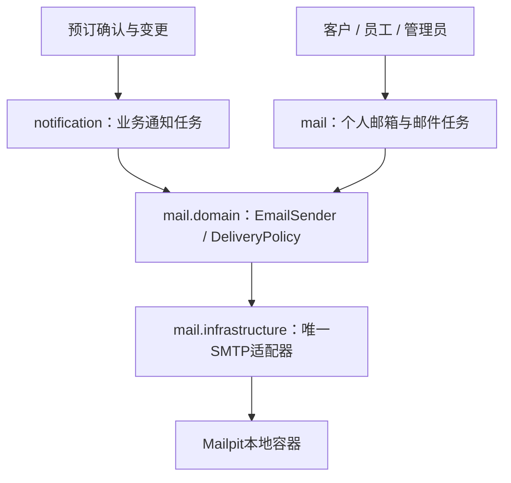

# 支付沙箱与邮件：配置、启动、联调

[返回文档导航](README.md) · [基础运行指南](运行指南.md)

本指南对应当前代码：Java 21、Spring Boot、Docker MySQL 8.4、支付宝 Java SDK、Spring Mail/SMTP。依赖已经在 Maven 中声明，不需要额外安装支付 SDK 或本地 MySQL。外部控制台入口与配置说明于 2026-10-27 核对；账号权限、额度、费用和页面名称以你的控制台为准。

## 1. 先选联调阶段

| 阶段 | PAYMENT_MODE | EMAIL_MODE | 外部条件 | 能验证什么 |
| --- | --- | --- | --- | --- |
| 可选关闭渠道 | disabled | disabled | Docker | 非支付业务 |
| 完整本地业务 | mock | log | Docker | 模拟付款、取消、补退差价；邮件仅SIMULATED |
| 当前开发及生产部署 | mock | smtp | Docker Mailpit | 三角色邮箱、真实SMTP协议与邮件内容，不投递互联网邮箱 |
| 支付沙箱 | alipay-sandbox | log 或 smtp | 支付宝沙箱账号、RSA2密钥、HTTPS回调地址 | 沙箱付款、查询、关单、退款 |
| 真实邮件 | mock 或 alipay-sandbox | smtp | SMTP账号、已验证发信地址 | 实际收件、提醒、投递异常 |

当前开发版和生产/部署版均启用mock与Mailpit，无需付费邮箱或公网支付回调。部署版由 `config/compose.yaml` 直接配置渠道与任务，运行命令见项目根README。下面的可选沙箱/互联网SMTP配置用于开发联调，读取 `config/development.env` 并使用 `Start-Backend.ps1`；部署版不会读取开发配置。

### 1.1 本次选择：持久化离线钱包沙箱

截至2026-10-28核对，**没有公网IP不意味着只能使用一键成功的mock**。以下方案侧重点不同：

| 方案 | 是否需要自备公网IP | 是否完全离线 | 对本项目的适用性 |
| --- | --- | --- | --- |
| Stripe官方沙箱 + Stripe CLI | 本地CLI可转发事件，无需自备公网IP | 否，需联网、Stripe账户与测试密钥 | 能验证第三方支付、拒付、认证等；不是本项目账户的6位支付密码系统 |
| `stripe/stripe-mock` Docker镜像 | 否 | 镜像准备后可离线 | 官方说明它无状态、响应基于固定数据，适合接口协议检查，不能提供完整余额/密码/退款账户体系 |
| **本项目钱包沙箱（已实现）** | **否** | **依赖准备后可离线** | **账户开通、密码授权、模拟充值、扣款、余额、交易与退款流水，直接连接现有预订/会员** |

依据：[Stripe本地Webhook监听](https://docs.stripe.com/webhooks#local-listener)、[Stripe沙箱测试](https://docs.stripe.com/testing)、[stripe-mock功能与限制](https://github.com/stripe/stripe-mock#features-and-limitations)。选择内置钱包是根据本项目的离线、密码流程和现有Java架构作出的工程判断；它不是支付宝、微信或Stripe官方沙箱。

实现保留在 `payment` 模块内，按 `MockPaymentController → SandboxWalletService → SandboxWalletRepository → JdbcSandboxWalletRepository` 分层。现有 `PaymentService` 负责业务确认，`MockPaymentGateway` 持久化渠道交易与退款。没有新增支付容器、SDK、收费服务或新的配置文件，继续使用 `PAYMENT_MODE=mock`；开发版和Docker部署版都可运行。

### 1.2 用户操作顺序

1. 登录顾客门户，打开“沙箱钱包”，或进入预订/会员/改订补款的付款页。
2. 首次输入**本项目登录密码**验证身份，设置并重复输入新的**6位数字沙箱支付密码**。密码仅供本项目使用，不输入真实银行卡/支付宝/微信支付密码。新钱包余额为 `0.00`，不自动赠送无限余额。
3. 展开“模拟充值”，选择100、1000或10000元，输入沙箱支付密码确认。此操作发放测试额度，不连接银行；充值后余额上限100万元。
4. 创建支付请求，选择“模拟支付宝”或“模拟微信”。两种方式共用同一沙箱钱包，保留原有渠道方法字段，不能理解为已经接入真实支付宝/微信。
5. 进入收银台，核对Holiday Booking收款方、应付单号、金额和余额，输入支付密码，点击带具体金额的“授权扣款”。**创建订单/支付请求都不会扣款或激活权益**。
6. 成功后余额扣减，预订变为CONFIRMED，或会员激活，或改订补款生效。返回业务页面刷新；若网络中断，先点“查询支付结果”，不要另建一笔付款。
7. “暂不付款”仅关闭确认表单；“取消当前交易”关闭该支付尝试，保留预订，可在订单到期前重新选择方式。它不等于取消预订。若付款与取消同时发生，以服务端交易结果为准。
8. 取消已付款预订或改订产生退款时，沿用既有退款流程；渠道退款成功后返还原钱包。钱包页面分页查看充值、扣款、退款及每笔交易后余额。

支付密码使用BCrypt（cost=12）单独保存，不存明文、不回传给前端、不写审计详情。前端不保存到localStorage，提交后清空输入。首次登录密码校验与后续支付密码验证共用钱包失败计数：连续错误5次锁定15分钟；锁定记录保存在MySQL，重启不能清除。可用原支付密码修改密码；**忘记支付密码的身份找回流程尚未实现**，不提供无验证重置入口。

### 1.3 API输入与输出

路径统一加 `/api/v1`；所有接口要求登录，写操作要求Session Cookie和有效CSRF。钱包用户由会话确定，不能传其他人的userId。成功统一返回 `{ "data": ..., "traceId": "..." }`；金额为两位小数字符串，ID为字符串，时间为UTC ISO格式。

| 功能 | 方法与路径 | 具体输入 | 预期data |
| --- | --- | --- | --- |
| 钱包状态 | GET `/sandbox/wallet` | 无body | 首次为 `{"configured":false,"balance":"0.00","currency":"CNY","attemptsRemaining":5,"lockedUntil":null}` |
| 首次设置密码 | POST `/sandbox/wallet/setup` | `{"loginPassword":"自己的项目登录密码","pin":"824631","confirmation":"824631"}` | 钱包状态，configured=true，balance仍0.00；重复设置409 PIN_ALREADY_SET |
| 模拟充值 | POST `/sandbox/wallet/credits` | Header `Idempotency-Key: wallet-credit-001`；body `{"amount":"1000.00","pin":"824631"}` | 首次余额1000.00；同一键同金额重试仍1000.00，不重复充值 |
| 修改密码 | PUT `/sandbox/wallet/pin` | `{"oldPin":"824631","pin":"635284","confirmation":"635284"}` | 钱包状态；随后只接受新密码 |
| 创建支付尝试 | POST `/payment-orders/P/attempts` | Header `Idempotency-Key: payment-start-001`；`{"amount":"200.10","method":"Alipay"}`，金额须等于服务端订单 | 原应付单结构，新增provider=MOCK；attempts包含待确认尝试A |
| 授权付款 | POST `/sandbox/payment-attempts/A/authorize` | `{"pin":"824631"}`；不接受客户端指定实际扣款金额 | 应付单status=SUCCEEDED，尝试SUCCEEDED，paidAt有值；1000.00余额减为799.90 |
| 取消本次交易 | POST `/sandbox/payment-attempts/A/cancel` | 无body | 尚未付款的尝试CLOSED，应付单仍PENDING；已付款时保留成功结果 |
| 查询支付结果 | POST `/payment-orders/P/refresh` | 无body | 查询持久化渠道结果并恢复业务状态，不重复扣款 |
| 资金流水 | GET `/sandbox/wallet/entries?page=0&size=20` | page从0开始，size为1到100 | 数组；每项包含id、kind、reference、amount、balanceAfter、createdAt；PAYMENT金额为负数，CREDIT/REFUND为正数 |

例如扣款流水：`{"id":"123","kind":"PAYMENT","reference":"PAYMENT:HB...","amount":"-200.10","balanceAfter":"799.90","createdAt":"2026-10-28T12:00:00Z"}`。日期、ID、交易号由服务端实际生成。退款仍使用原 `/refunds/{id}/refresh`，前端不提交退款金额。

| 拒绝场景 | HTTP / code | 是否扣款 |
| --- | --- | --- |
| 未设置支付密码 | 409 / PIN_NOT_SET | 否 |
| 密码错误（未达到锁定阈值） | 403 / SANDBOX_CREDENTIAL_INVALID | 否，剩余次数减少 |
| 第5次错误及锁定期间 | 429 / SANDBOX_WALLET_LOCKED | 否 |
| 余额不足 | 409 / SANDBOX_INSUFFICIENT_FUNDS | 否 |
| 已关闭、到期或渠道尚不确定 | 409 / ORDER_NOT_PAYABLE | 否；先查询结果 |
| 渠道记录金额与服务端订单不符 | 409 / SANDBOX_AMOUNT_MISMATCH | 否 |
| 尝试支付别人的应付单 | 404 / NOT_FOUND | 否 |
| 金额篡改、非法PIN格式、两次PIN不一致 | 422 / 对应字段或业务错误码 | 否 |
| 未登录 / 缺少CSRF | 401 / 403 | 否 |

同一支付尝试以商户交易号作为扣款幂等键，重复点击、请求重试及并发提交不会重复扣款。余额变化、扣款流水与mock渠道PAID写入同一数据库事务；业务确认在后续事务执行。若扣款已提交但业务确认暂时失败，主动查询/后台恢复会继续处理，不能因页面错误再次扣款。退款记录与钱包返还也在同一事务，以退款号防重。

旧HTTP入口 `/api/v1/dev/payment-attempts/{id}/succeed` **已删除**。内部 `simulate` 仅保留给预设数据装载和既有测试夹具，没有对应浏览器入口。V5之前的成功mock交易和预置已付款订单没有钱包扣款记录：不追扣余额，退款也不凭空增加钱包余额；新的用户收银台付款都会产生对应资金流水。

### 1.4 更新、运行与验证

本次有Java/Vue源码变更及新增Flyway `V5__sandbox_wallet.sql`。**已有镜像不会自动包含新代码**；`-PrepareImages`只补缺失镜像，不会更新现有镜像。

```powershell
# 开发版：停止旧后端后打包一次，再日常启动。Vue热更新会读取新页面。
.\backend\mvnw.cmd -f .\backend\pom.xml -DskipTests package
powershell.exe -NoProfile -ExecutionPolicy Bypass -File .\scripts\Start-System.ps1 -Mode Development

# Docker部署版：明确更新两个应用镜像一次；复用MySQL/Mailpit镜像和原数据卷。
docker compose --env-file config/deployment.env -f config/compose.yaml -f config/compose.build.yaml build backend frontend
docker compose --env-file config/deployment.env -f config/compose.yaml up -d --no-build --pull never --wait --wait-timeout 300
```

启动后Flyway自动创建钱包及流水表，不修改已执行迁移、不删除既有数据；无需额外环境变量。之后日常启动继续不构建。后台恢复需要 `JOBS_ENABLED=true`，当前开发模板及部署配置已启用。

新增12项Java用例在 `payment/SandboxWalletTest.java` 与 `payment/SandboxWalletApiTest.java`，已纳入独立 `SandboxPayment` 模块；具体输入、预期及待填实际结果见[集成测试表](testing/02-集成测试.md)。自行执行：

```powershell
powershell.exe -NoProfile -ExecutionPolicy Bypass -File .\scripts\Test-Backend.ps1 -Modules SandboxPayment
```

本轮只做编译、格式及前端静态/构建检查，未执行上述数据库业务测试，也未实际迁移工作库或运行整套Docker栈。实际并发、退款与浏览器流程仍需按用例验收。真实资金结算、真实银行认证、第三方Webhook及争议处理不属于这个自建离线沙箱；将来接入真实支付商时需使用其官方托管收银台，不能把本项目PIN转交给支付商。

工具环境验证说明：Java源码及测试代码已通过编译，JAR已重新打包；当前缓存缺少默认jar插件的POM，本次打包验证显式使用已缓存的maven-jar-plugin 3.4.2，未修改项目pom。前端通过vue-tsc、ESLint及Vite生产构建；工具环境构建跳过了受限的Windows可选网络盘探测，标准npm构建命令保持不变。用例目录共83项，新钱包模块12项，未覆盖原results报告。

## 2. 统一文件配置与启动

已有 `config/development.env` 时只增补字段，**不要用模板覆盖现有数据库密码**。每个键只能出现一次；有逗号、Base64中的 `=` 或特殊字符时用单引号，密钥放在一行，不支持多行 PEM。文件不会作为脚本执行，也不会提交到 Git。

```dotenv
# 保留原 MYSQL_*、SERVER_PORT 等字段，只按需要修改下面的模式。
PAYMENT_MODE=mock
EMAIL_MODE=smtp
JOBS_ENABLED=true
REMINDER_DAYS='3,1'
```

`JOBS_ENABLED=true` 启用支付到期恢复、退款恢复和邮件调度，默认约每60秒检查一次。邮件 disabled 时调度器保留通知队列，不尝试发送。`REMINDER_DAYS='3,1'` 开启入住前三天和一天当地09:00提醒，默认 `'1'` 保持基础模式。配置只影响新生成的任务，不自动为历史订单补建D3；新确认订单已错过的提醒记为SKIPPED。

```powershell
# 在项目根目录；先检查配置，不启动Java或容器。
powershell.exe -NoProfile -ExecutionPolicy Bypass -File .\scripts\Start-Backend.ps1 -CheckOnly
# 停止原8080后端后，用同一命令重新启动。
powershell.exe -NoProfile -ExecutionPolicy Bypass -File .\scripts\Start-Backend.ps1
```

CheckOnly只检查文件、工具及Compose语法，**不验证渠道密码、签名或投递能力**。修改文件后必须重启后端；脚本退出会恢复当前进程原环境变量。旧配置不增加任何字段仍默认禁用渠道。启动时Flyway应用尚未执行的迁移（当前至V5）；保留原订单、变更、邮件和钱包数据。不要修改已经执行过的迁移，也不要删除开发数据卷。

切换mock和沙箱前应结清或记录原渠道的未完成订单。两种渠道交易不可互换：旧mock订单不能由沙箱接管，退款恢复也核对原provider。

## 3. 支付宝沙箱

### 3.1 获取账号和密钥

1. 用自己的实名认证支付宝账号登录[支付宝开放平台](https://open.alipay.com/paymentServicer/paymentProvider.htm)，进入开发工具/沙箱环境。使用**国内开放平台的当面付扫码支付**能力，与Alipay+、国际支付网关不是同一接入方式。查看沙箱应用是否具备 `alipay.trade.precreate`、query、close、refund及退款查询权限。
2. 记录沙箱应用 `APPID`。在沙箱账号页记录卖家PID（数字用户ID）、买家账号与付款工具；卖家PID不是登录邮箱，也不是APPID。买家和卖家应为不同沙箱身份。按控制台当前提供的沙箱客户端或付款方式操作，正式支付宝账号不能替代沙箱身份。[官方沙箱扫码支付介绍](https://open.alipay.com/paymentServicer/paymentProvider.htm)
3. 按平台密钥工具生成RSA2密钥对。保存**应用私钥**；将对应的**应用公钥**配置到沙箱应用；再复制平台提供的**支付宝沙箱公钥**。
4. 本项目采用公钥模式，不是应用证书模式。应用私钥需为PKCS8 Base64正文，去掉BEGIN/END行与换行；支付宝公钥也使用单行Base64正文。不要把应用公钥填成支付宝公钥。

| 文件变量 | 来源及用途 |
| --- | --- |
| ALIPAY_APP_ID | 沙箱应用APPID |
| ALIPAY_PRIVATE_KEY | 应用私钥，服务端签名；不能给前端 |
| ALIPAY_PUBLIC_KEY | 支付宝沙箱公钥，校验响应和回调 |
| ALIPAY_SELLER_ID | 沙箱卖家PID，校验收款方 |
| ALIPAY_NOTIFY_URL | 支付宝能访问的HTTPS异步通知地址 |

当前适配器限定网关 `https://openapi-sandbox.dl.alipaydev.com/gateway.do`，禁止替换为生产网关后直接当作生产接入。[支付宝官方沙箱示例](https://aipay.alipay.com/products)

### 3.2 准备HTTPS回调

localhost和内网IP不能供支付宝从公网回调。可使用已有HTTPS测试服务器反向代理到后端，或由你选择的隧道工具提供HTTPS地址。需要满足：

- URL精确为 `https://你的测试域名/api/v1/payment-callbacks/alipay`；不要写Swagger地址、浏览器返回页或前端路径。
- 代理保持POST方法及 `application/x-www-form-urlencoded` 表单内容，不附加登录挑战，不重写表单值。
- 此回调路径已经免登录、免CSRF，但仍严格验签并核对应用、卖家、金额等；不应放开其他后台接口。
- 本地联调只需将回调路径代理到8080。测试隧道地址变化后要更新配置并重启；旧支付尝试的回调地址不会随文件自动改变。
- 如整个应用通过HTTPS访问，设置 `SESSION_COOKIE_SECURE=true`；仅回调走HTTPS、浏览器仍访问本地HTTP时保留false，否则浏览器可能无法保持登录。

### 3.3 写入文件

```dotenv
PAYMENT_MODE=alipay-sandbox
EMAIL_MODE=log
JOBS_ENABLED=true
ALIPAY_APP_ID='REPLACE_WITH_SANDBOX_APP_ID'
ALIPAY_PRIVATE_KEY='REPLACE_WITH_PKCS8_BASE64_PRIVATE_KEY'
ALIPAY_PUBLIC_KEY='REPLACE_WITH_ALIPAY_BASE64_PUBLIC_KEY'
ALIPAY_SELLER_ID='REPLACE_WITH_SANDBOX_SELLER_PID'
ALIPAY_NOTIFY_URL='https://your-test-domain.example/api/v1/payment-callbacks/alipay'
```

替换所有示例值，执行CheckOnly，再启动。HTTP后端正常启动只证明配置被读取；首次下单成功、验签成功和实际付款必须另外核验。

### 3.4 付款与退款验收顺序

先按[运行指南](运行指南.md#7-测试启动登录与-api-文档)建立开发库账户、管理员、会话及CSRF。以下路径都以 `/api/v1` 开头；所有用户写请求带Cookie和最新CSRF，指定幂等键的请求还需 `Idempotency-Key`。成功业务响应统一包在 `data` 中。

| 顺序 | 请求与具体输入 | 核验结果 |
| --- | --- | --- |
| 1 管理员建房型 | POST `/admin/room-types`，`{"name":"Sandbox Room","description":"Integration room","capacity":2,"basePrice":100.00}` | 记录 `data.id` 为T |
| 2 管理员建实体房 | POST `/admin/rooms`，`{"roomTypeId":T,"number":"SB-101"}` | 成功；重复房号不能重复创建 |
| 3 顾客报价 | POST `/quotes`，`{"checkIn":"2030-01-10","checkOut":"2030-01-12","rooms":[{"roomTypeId":T,"rooms":1,"guestsPerRoom":1}]}` | **替换为执行当天起7天后、且365天内的日期**；记录quoteId及totalAmount；非会员且未调价时200.00 |
| 4 创建预订 | POST `/bookings`，`{"quoteId":Q,"contactName":"Sandbox Guest","contactEmail":"你的测试收件邮箱","contactPhone":"13800000000"}`，幂等键如 `sandbox-booking-001` | 记录B和paymentOrderId=P；状态PENDING_PAYMENT |
| 5 发起支付 | POST `/payment-orders/P/attempts`，`{"amount":"上一步totalAmount原值","method":"Alipay"}`，幂等键 `sandbox-payment-001` | attempts中的checkoutUrl包含沙箱二维码内容；金额不得自行减少 |
| 6 沙箱付款 | 用沙箱买家按控制台支持方式付款；如需生成二维码，使用本地工具渲染checkoutUrl | 扫码内容不一定是可直接点击的网页，不能仅靠打开URL判定失败 |
| 7 查单 | GET `/payment-orders/P`；未更新时POST `/payment-orders/P/refresh` | 支付SUCCEEDED，预订GET `/bookings/B` 为CONFIRMED；重复查询不重复确认 |
| 8 取消退款 | 按下一节创建取消报价并提交；GET变更记录取refunds里的退款ID，POST `/refunds/ID/refresh` | 取消状态与退款状态分别显示；渠道确认后SUCCEEDED；后台任务也会恢复 |

旧 `/dev/payment-attempts/{id}/succeed` HTTP入口已移除，任何模式均不可用。不能把手工伪造回调或数据库改状态算作真实联调。要验证重复回调，使用供应商提供的重发能力并记录同一交易号；退款超时恢复使用同一个 `out_request_no`，不可换退款号重复请求。[官方退款查询语义](https://aipay.alipay.com/docs/vibe-pay/ai-web-app-payment-qianyi/api-list/alipay-trade-fastpay-refund-query.html)

## 4. 先用Mailpit验证邮件，无需真实邮箱账号

Mailpit接收SMTP并在本机网页展示邮件，不会发送给互联网收件人。官方Docker镜像默认SMTP端口1025、网页端口8025。[官方安装说明](https://mailpit.axllent.org/docs/install/docker/)

Compose已经包含Mailpit。配置下方字段后，从项目根目录运行同一个启动入口即可依次启动MySQL、Mailpit和后端，无需每次设置环境变量：

```powershell
powershell.exe -NoProfile -ExecutionPolicy Bypass -File .\scripts\Start-Backend.ps1
```

脚本识别已有的 `holiday-mailpit`：若属于本项目Compose则由Compose管理；若是你手动创建的容器，则启动并复用，不删除、不迁移其邮件。已有容器必须映射所配置的1025/8025端口。新建Compose容器使用 `mailpit-data` 卷；手动容器原先是否持久化，取决于其原有挂载。请勿执行 `docker compose down -v` 删除数据卷。

开发后端当前运行在宿主机，因此SMTP主机填127.0.0.1；以后Java也进入容器时应使用Docker网络中的服务名，不要继续填容器自身的localhost。

```dotenv
PAYMENT_MODE=mock
EMAIL_MODE=smtp
JOBS_ENABLED=true
MAILPIT_ENABLED=true
MAILPIT_PORT=1025
MAILPIT_WEB_PORT=8025
REMINDER_DAYS='3,1'
MAIL_HOST=127.0.0.1
MAIL_PORT=1025
MAIL_FROM='booking@example.test'
MAIL_USERNAME=''
MAIL_PASSWORD=''
MAIL_SMTP_AUTH=false
MAIL_STARTTLS=false
MAIL_SSL_ENABLE=false
MAIL_HEALTH_ENABLED=true
MAIL_RECIPIENT_ALLOWLIST=''
EMAIL_DAILY_LIMIT=50
```

重启后端；按上表建立contactEmail为 `guest@example.test` 的订单，发起mock支付后按第1节先设置钱包密码、模拟充值，再以同一用户POST `/api/v1/sandbox/payment-attempts/A/authorize`，body为自己的沙箱支付密码。打开 `http://localhost:8025`，等待约60秒查看确认邮件。管理员GET `/api/v1/admin/notifications` 核对任务SENT。此SENT仅证明Mailpit接受，不是互联网邮箱收到。

D3/D1在预定时点到达后才发送。不要修改开发机日期或把数据库字段改成已发送；日期边界先用 `Test-Backend.ps1 -Modules Notification` 的固定时钟用例核验，实际定时投递再安排未来日期的订单观察。取消与改订会抑制旧版本未发任务；已进入SMTP发送过程的邮件无法撤回。

### 4.1 每个账户自己的邮箱

**个人邮箱由本项目的MySQL和接口提供，Mailpit负责接收SMTP副本。** 不需要给每个账户创建一个容器，也不需要在.env中列出每个邮箱。注册时的email就是账户收发地址；客户、员工、管理员可互发给任意已启用注册账户，也可给自己发信。邮箱精确匹配时忽略首尾空格及大小写。不存在或停用的收件人返回404。

Mailpit的8025页面是开发人员查看全部捕获邮件的工具，不能作为普通用户的个人邮箱。它不会自动向QQ/Gmail等互联网邮箱投递，也不会把外部系统直接发给Mailpit的邮件导入本项目。若要互联网收发，需要额外的SMTP转发及入站邮件接入；当前不启用。[Mailpit SMTP说明](https://mailpit.axllent.org/docs/configuration/smtp/)、[转发说明](https://mailpit.axllent.org/docs/configuration/smtp-relay/)。

| 能力 | CUSTOMER | STAFF | ADMIN |
| --- | --- | --- | --- |
| 本人收件箱、发件箱、未读数、回复、移入回收站/恢复 | ✓ | ✓ | ✓ |
| 普通邮箱接口读取别人的邮件 | 禁止 | 禁止 | 禁止 |
| 管理接口查看全站邮件，按发件人/收件人/状态筛选 | 禁止 | 禁止 | ✓ |
| 管理接口查看正文及人工重试个人邮件 | 禁止 | 禁止 | ✓，记录审计 |

“全站邮件”包括本应用创建的个人邮件、预订确认和提醒任务，包含待投递、失败以及用户移入回收站的记录。不是Mailpit中任意外部应用邮件的全集。管理员读正文不会代替收件人标记已读。

持久化分层：`mail/api`处理协议和参数，`mail/application`处理所有权、幂等和队列投递，`mail/domain`定义仓储端口，`mail/infrastructure`实现MySQL查询；复用现有SMTP适配器、身份认证和审计。Flyway V4增加邮件表及系统通知的已读/删除记录，无需手工建表。历史通知创建时间不可追溯时返回null。

#### notification与mail的职责边界

保留两个业务模块，统一邮件传输能力。它们仍在同一个Spring Boot应用中运行，不是两个微服务。

| 模块 | 负责 | 不负责 |
| --- | --- | --- |
| notification | 根据预订版本生成确认信、计算D3/D1提醒时点、检查预订是否仍有效、抑制过期任务、管理系统通知任务 | 个人发信、回复、读状态及邮箱权限 |
| mail | 三角色个人邮箱、管理员查信、个人邮件队列；提供通用EmailSender端口、ConfiguredEmailSender适配器及DeliveryPolicy重试策略 | 计算预订提醒日期、决定取消/改订后的通知有效性 |



两类任务各自领取和校验：通知依赖预订版本、入住截止时间，个人邮件依赖发件账户及收件账户。保留两张业务表可避免给每封个人邮件增加无关bookingId，也避免把收件箱权限混入提醒任务。**同一封系统通知不会再复制为个人邮件排队发送**；邮箱仓储通过只读联合查询将已投递系统通知展示在收件箱，已读/删除状态单独保存。此处是单体应用内部明确的数据库读模型关联，并非模块完全数据库隔离。

实际SMTP发送只有一个实现；1/5/30分钟退避、最多4次及接受状态判定只有一份DeliveryPolicy；两队列共用现有每日配额记录。Java依赖方向为notification使用mail的通用传输端口，mail领域不依赖NotificationRepository.Task。测试对应拆分为Notification（业务提醒规则）、Mail（邮箱及通用适配器）、MailpitSmoke（显式启用的容器检查）。

### 4.2 接口与输入输出

在 `http://localhost:8080/swagger-ui/index.html` 查看完整OpenAPI结构。先按[运行指南](运行指南.md)登录并获取会话Cookie及CSRF；所有写请求带CSRF，发信额外带 `Idempotency-Key`（每封新邮件用不同UUID，网络重试复用原值）。下表路径前缀为 `/api/v1`。

| 功能 | 方法与路径 | 输入 | 成功输出 |
| --- | --- | --- | --- |
| 验证收件人 | GET `/mail/recipient?email=staff@holiday.test` | 已注册邮箱；不提供全站通讯录枚举 | 200，data含email、displayName |
| 发信 | POST `/mail/messages` | `{"recipientEmail":"staff@holiday.test","subject":"Arrival question","body":"Please confirm check-in time."}` | 202，data为邮件详情，id如M123、state=READY |
| 回复 | POST `/mail/messages` | `{"recipientEmail":"customer@holiday.test","subject":"Re: Arrival question","body":"Check-in is at 15:00.","replyToId":"M123"}` | 202，新的M编号；仅原收件人可回复原发件人；系统N邮件不能回复 |
| 邮箱列表 | GET `/mail/messages?folder=INBOX&page=0&size=20&unreadOnly=false` | folder为INBOX/SENT/TRASH；unreadOnly仅INBOX支持；size为1至100 | 200，data={items,page,size,total}；items中body=null |
| 未读数 | GET `/mail/unread-count` | 无 | 200，data={"count":1} |
| 读正文 | GET `/mail/messages/M123` | 本人可见的邮件ID | 200，完整详情；GET不会自动标记已读 |
| 已读/未读 | PUT `/mail/messages/M123/read` | `{"read":true}` / `{"read":false}` | 200，详情readAt为UTC时间/null；仅收件人可操作 |
| 删除/恢复副本 | PUT `/mail/messages/M123/visibility` | `{"folder":"INBOX","deleted":true}`；恢复用false；发件副本用SENT | 200，data=null；只改变自己的副本，不影响对方；不物理删除 |
| 重试失败邮件 | POST `/mail/messages/M123/retry` | `{"acknowledgeUnknown":false}`；UNKNOWN明确确认重复风险后用true | 200，state=READY；只允许发件人操作，SENT不能重试 |
| 全站查询 | GET `/admin/mail/messages?page=0&size=20` | 可选senderEmail、recipientEmail精确邮箱、state状态 | 200，分页结构同上；包含全部用户，列表不返回正文 |
| 管理员读正文 | GET `/admin/mail/messages/M123` | M个人邮件或N系统通知ID | 200，完整详情；写READ_ALL_MAIL审计 |
| 管理员重试 | POST `/admin/mail/messages/M123/retry` | 同个人重试 | 200，READY；系统通知沿用原`/admin/notifications/{数字ID}/retry`接口 |

详情示例（动态ID和时间以实际返回为准）：

```json
{
  "data": {
    "id": "M123", "kind": "PERSONAL",
    "senderId": "10", "recipientId": "11",
    "senderEmail": "customer@holiday.test", "recipientEmail": "staff@holiday.test",
    "subject": "Arrival question", "body": "Please confirm check-in time.",
    "replyToId": null, "createdAt": "2026-10-27T14:00:00Z",
    "deliveredAt": null, "readAt": null,
    "senderDeleted": false, "recipientDeleted": false,
    "state": "READY", "attempts": 0, "lastError": null
  },
  "traceId": "本次请求追踪号"
}
```

正文为纯文本1至10000字符，主题1至200字符且不允许换行；不支持附件/HTML。发件身份取登录账户，客户端不能指定senderId/from。SMTP使用配置的MAIL_FROM作为From，用户地址作为Reply-To；因此Mailpit里From显示系统地址，而应用显示实际发送者。发件人无法通过详情窥视对方readAt或删除状态；收件人看不到发送失败内部详情。系统邮件kind=SYSTEM、ID为N加数字、senderEmail为SYSTEM、senderId为null。

错误沿用统一错误响应：未登录401、管理员接口越权/缺少CSRF为403、他人邮件或不存在收件人为404、参数业务校验422、幂等冲突/不可重试409、每小时超过30封429。格式以OpenAPI及既有错误协议为准。

### 4.3 投递、验收顺序和结果

1. 启动脚本后，访问8025确认Mailpit页面可用。数据库和后端不需要手工配置环境变量。Compose端口只绑定127.0.0.1。
2. 按现有注册/管理员初始化流程准备三个不同账户，如customer@holiday.test、staff@holiday.test、admin@holiday.test；注册默认CUSTOMER，管理员通过已有角色接口将员工升为STAFF。示例邮箱不是系统内置账户，不会自动创建。
3. 使用三个独立浏览器会话或Postman Cookie会话。客户调用发信接口；员工立即查询可能仍无邮件。后台约每60秒扫描，SMTP接受后state=SENT、deliveredAt有值、员工收件箱未读数增加。Mailpit可按 `to:staff@holiday.test` 搜索副本。
4. 员工读取、标已读并回复客户；管理员使用普通邮箱接口发信，并使用管理接口查看客户与员工往来。普通用户查别人的M编号应404；员工查管理邮箱应403。
5. 发件人和收件人分别删除自己的副本，检查对方仍可见、管理员仍可见；恢复后重回原文件夹。相同幂等键和相同输入重试只产生一封；改变内容必须换键。
6. 预订contactEmail填注册邮箱，mock付款后确认通知以N编号进入该账户收件箱。联系邮箱若不是注册账户，仍可通过SMTP捕获及管理接口查看，但没有对应个人收件箱。

状态：READY待发送 → SENDING领取租约 → SENT服务器已接受。可重试失败按1/5/30分钟退避，共最多4次；最终FAILED。网络结果不确定或租约过期为UNKNOWN，必须人工确认后重试，可能产生SMTP重复副本。SMTP与数据库不能组成同一事务，不宣称恰好一次。log模式的SIMULATED会进入模拟收件箱，但并未发送至Mailpit；当前本地配置采用smtp。disabled时不投递。每账户每小时最多新建30封；个人信件和预订通知共用EMAIL_DAILY_LIMIT每日尝试预算，用完保留待投递，下一天再处理。

测试按模块选择，实际输出写入原results机制及测试文档；新增用例未预先执行：

```powershell
# MySQL功能测试；SMTP为测试替身，不依赖已启动的8080后端
.\scripts\Test-Backend.ps1 -Modules Mail,Notification

# 单独验证真实本地Mailpit：需先启动容器，显式允许发一封本地测试信
.\scripts\Test-Backend.ps1 -Modules MailpitSmoke -MavenOptions '-Dmailpit.smoke=true'
# 修改端口时追加 -Dmailpit.smtp.port=... 和 -Dmailpit.http.port=...
```

MailpitSmoke未显式开启时跳过，不会让普通全选测试依赖SMTP容器。它使用唯一主题验证SMTP接受及Mailpit搜索结果，保留容器既有邮件；它不代替Mail模块的身份与权限测试。当前只完成编译和静态检查，本次工具环境无法访问Docker引擎，尚未确认本机容器真实投递结果。三角色个人邮箱及管理员全站邮箱Vue页面已接入，运行与验收见[前端README](../frontend/README.md)。

## 5. 接入真实SMTP：以阿里云DirectMail为例

其他支持标准SMTP的服务商也可使用相同适配器。本项目不使用邮件服务商HTTP API，所以不需要AccessKey；需要的是发信地址及其SMTP密码。

1. 登录阿里云，开通邮件推送DirectMail，选择服务区域；查看你的账号实际可用权限与配额。区域内创建的发信地址必须使用该区域SMTP服务。[官方准备流程](https://help.aliyun.com/zh/direct-mail/user-guide/overview)
2. 准备可管理DNS的域名，建议使用单独发信子域名。按照控制台为该域名生成的记录配置DNS并验证，不能照抄别人的记录；新域名的校验项包括SPF、DKIM、DMARC和MX。[发信域名设置](https://help.aliyun.com/zh/direct-mail/user-guide/how-to-configure-sending-domain-names)
3. 创建发信地址，例如 `booking@mail.your-domain.example`，设置这个地址的SMTP密码。`MAIL_USERNAME` 和 `MAIL_FROM` 使用该已验证地址，`MAIL_PASSWORD` 使用SMTP密码而非阿里云登录密码。[官方操作导航](https://help.aliyun.com/zh/direct-mail/user-guide/overview)
4. 查看所选区域SMTP端点。杭州区域示例为 `smtpdm.aliyun.com`，可使用465隐式TLS；不要假设所有服务商都支持587。[官方区域端点与端口](https://help.aliyun.com/en/direct-mail/smtp-endpoints)
5. 在文件中替换下面字段，先只允许一个自己的收件邮箱；重启并完成一笔预订确认。检查收件箱、垃圾箱和服务商投递记录。

```dotenv
EMAIL_MODE=smtp
JOBS_ENABLED=true
MAILPIT_ENABLED=false
MAIL_HOST=smtpdm.aliyun.com
MAIL_PORT=465
MAIL_USERNAME='booking@mail.your-domain.example'
MAIL_FROM='booking@mail.your-domain.example'
MAIL_PASSWORD='REPLACE_WITH_SMTP_PASSWORD'
MAIL_SMTP_AUTH=true
MAIL_STARTTLS=false
MAIL_SSL_ENABLE=true
MAIL_HEALTH_ENABLED=true
MAIL_RECIPIENT_ALLOWLIST='your-test-inbox@example.com'
EMAIL_DAILY_LIMIT=50
```

若服务商明确要求587+STARTTLS，则改端口587、MAIL_STARTTLS=true、MAIL_SSL_ENABLE=false；不能同时开启两种TLS。多个允许收件人使用单引号包裹的逗号分隔列表。每日额度是应用发送尝试预算，不替代服务商配额。SMTP返回成功表示服务器接受，仍可能退信；当前没有退信Webhook处理。

## 6. 取消、改订与退款接口

政策版本 `FREE_24H_V1`：已确认订单距原入住时刻至少24小时才允许取消或改订；改订后的入住也至少在24小时后。取消全额退剩余可退金额，改订按当前房价和当前有效会员资格重新计算整单；旧价保留在历史版本。尚未结清退款或正在补款时不能再发起变更。

| 请求（均为本人资源） | JSON输入 | 返回重点 |
| --- | --- | --- |
| POST `/api/v1/bookings/B/cancellation-quotes` | 无请求体 | data.id=C；kind=CANCEL；priceDifference为负退款额或0；state=QUOTED |
| POST `/api/v1/bookings/B/cancellations` | `{"changeQuoteId":C}`；带Idempotency-Key | state=APPLIED；预订CANCELLED；refunds分别列出各笔退款 |
| POST `/api/v1/bookings/B/amendment-quotes` | `{"checkIn":"有效入住日期","checkOut":"有效离店日期","rooms":[{"roomTypeId":T,"rooms":1,"guestsPerRoom":1}]}` | data.id=C；proposedStay为完整新行程；priceDifference正数补款、负数退款、0无差价 |
| POST `/api/v1/bookings/B/amendments` | `{"changeQuoteId":C}`；带Idempotency-Key | 不补款时APPLIED；需补款时AWAITING_PAYMENT和paymentOrderId |
| GET `/api/v1/bookings/B/changes/C` | 无 | 变更状态、源版本、报价及退款状态 |
| GET `/api/v1/refunds/R` | 无 | state=PENDING/UNKNOWN/SUCCEEDED；amount为该笔退款额 |
| POST `/api/v1/refunds/R/refresh` | 无；带CSRF | 用原退款号查询/重试渠道，不能传入自定金额 |

补款使用普通 `/payment-orders/P/attempts` 接口，但P为变更返回的新应付单。只有补款确认后才切换预订版本和房晚；超时且查明未付后释放新增占房、保留原单。quote的expiresAt是报价提交期限，补款期限以paymentOrder的expiresAt为准。

未付款取消如有在途交易会先尝试关闭；仍不明确时返回409 PAYMENT_IN_PROGRESS并保留库存，稍后重试。若关闭期间确认已付款，旧零退款报价会失效，需重新报价。退款未知时不回退已取消/已改订的业务状态，也不换退款号；同一退款号恢复由用户refresh或后台任务执行。

金额不匹配、补款迟到等异常收款仍进入原支付异常复核流程，尚未自动退款/自动对账；不能将这部分人工复核理解成退款已完成。取消确认邮件、专用改订通知模板、完整HTTP权限组合与并发压力测试也仍待补齐。本轮Java用例与迁移代码尚待你执行验收。

## 7. 排查与交付证据

| 现象 | 核对顺序 |
| --- | --- |
| 配好变量却没有付款/邮件 | 确认编辑的是启动脚本实际读取的文件；确认模式；重启Java；JOBS_ENABLED是否true |
| 沙箱签名无效 | APPID与沙箱密钥是否同一应用；应用私钥是否PKCS8；是否误用应用公钥替代支付宝公钥 |
| 沙箱不支持接口/没有二维码 | 检查应用权限、卖家身份及渠道响应；UNKNOWN不代表付款失败，不应不停新建支付尝试 |
| 付款成功但页面未确认 | 回调公网可达、HTTPS证书、路径与表单是否正确；使用订单refresh核验；检查支付异常记录 |
| 退款长期UNKNOWN | 核对退款号、原渠道、账号余额/权限及供应商记录；保留同一个退款号，不能直接修改数据库为成功 |
| SMTP认证失败 | 发信地址及其SMTP密码、区域、端口和TLS方式 |
| SMTP显示SENT但没收到 | 区分Mailpit和互联网SMTP；查看垃圾箱、DNS验证、服务商投递/退信记录 |
| 邮件UNKNOWN | 可能服务商已接受；先核查，后台重试UNKNOWN需明确确认重复投递风险 |
| 邮件READY不发送 | 检查任务到期时间、JOBS_ENABLED、EMAIL_MODE、每日配额、预订状态和版本 |
| 请求401/403 | 401检查会话；403检查角色和CSRF；Swagger写请求的操作方法见运行指南 |

将实际验收记录放在 `results/` 的独立目录，记录日期、渠道、应用/订单标识、预订/支付/退款状态、邮件接收证据及失败恢复结果。报告不要包含私钥、SMTP密码、Cookie或CSRF token。现有Java自动测试始终用隔离MySQL和模拟渠道，不会因为开发文件启用了沙箱而自动花费真实资金或发出真实邮件。

本项目Docker部署版继续使用离线钱包与Mailpit。若将来切换真实资金支付，另需正式商户资质、真实渠道适配、HTTPS、凭据管理及对账；不要把离线沙箱验收视为真实支付商联调通过。
